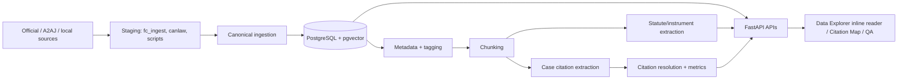

# AI CaseLibrary System Reference

Last updated: 2026-10-18

## Purpose And Authority

The active `/data-explorer` formatted reader offers **Similar paragraphs** for
numbered paragraphs. `GET /cases/{case_id}/paragraphs/{n}/similar?limit=10`
ranks other cases by one point per shared stored V3 tag and two per
shared cited case authority, then case ID and paragraph number. It verifies
exact canonical spans (including tags without chunk IDs), not chunk indices
or cited pinpoints. Citation occurrences are rebased from their containing chunk;
short-form anchors remain document-relative and may precede that chunk, but must
match canonical text and end before the absolute occurrence start.
Indexed postings, source signals, candidate cases and
paragraph rows are capped; coverage is explicitly non-exhaustive. Ambiguous
or unverified chunks/spans and statutes are excluded. Bare-numbered SCC chunks
require the actual canonical `Decision Content` marker and preceding numbering:
only a bounded prefix plus chunk is formatted, never a full candidate decision
retrieval. Chunks beyond that context cap or with ambiguous numbering are omitted.
Unresolved authority labels use separate ordered equality seeks, in sorted label
order, sharing one total postings budget and one lookahead per signal. Candidate
IDs merge deterministically; exhausted budgets or unvisited labels mark coverage
partial. Migration
`0031_paragraph_similarity` supplies the ORM-mirrored posting indexes; deployment
must review/apply it separately.
The offline migration graph test expects `0031_paragraph_similarity` as its
single head; it does not apply migrations to a database.

This is the canonical description of the active AI CaseLibrary system. It
consolidates current-purpose material formerly spread across `README.md`,
`docs/history/SYSTEM_OVERVIEW_2026-08-12.txt`, historical handoffs, and related
runbooks. `docs/history/GUIDANCE.md` is retained only as a superseded strategic
snapshot.

Use this document for current architecture, functionality, data flow, repository ownership, operations, validation posture, and known limitations. `CHANGELOG.md` remains the chronological record; `ROADMAP.md` and `MASTER_IDEAS.md` remain forward-looking; `OVERNIGHT.md` is the repository atlas and bounded overnight operations guide; `docs/EXTRACTION_35K_RUNBOOK.md` remains a focused procedural runbook. Files under `docs/history/` are historical snapshots and must not be used for live counts or API contracts.

For a time-bounded work narrative and estimated five-minute-capped session
effort, see the generated [WORK_HISTORY.md](WORK_HISTORY.md) snapshot. Its
coverage and totals are not live project or cost metrics; do not copy them into
current-state documentation.

The maintained long-term direction for citation-treatment intelligence,
Decision Units, Argument Packets, and cross-case argument comparison is
documented in [docs/LONG_TERM_INTELLIGENCE_VISION.md](docs/LONG_TERM_INTELLIGENCE_VISION.md).
That document is strategic and must not be read as evidence that deferred
intelligence layers are already implemented.

## Project Effort And Delivery History

The generated work-history file is the sole owner of its changing session
coverage, estimates, and narrative. Those estimates omit unrecorded work and
must not be treated as a complete timesheet, project cost, billable time, or
productivity measure.

AI CaseLibrary is a research aid, not legal advice. All legal conclusions and critical source details must be verified against authoritative materials.

### How To Use This Handbook

Read the product, architecture, data model, operations, validation, and review sections here for the current system picture. Use the linked reference documents for complete route, schema, configuration, source, script, recovery, UI, metric, testing, and change-process detail. Where a live count matters, query the corresponding API or database rather than relying on a dated document snapshot.

## Product Scope

AI CaseLibrary is a Canadian legal research system, currently optimized for immigration litigation. It preserves judicial decisions and supporting sources, enriches them with deterministic legal structure, and provides searchable case, citation, statute, judge, and Federal Court activity views.

The central operating principle is:

> Preserve source records first, enrich them second, and keep every derived signal traceable to stored source material.

The system intentionally separates three kinds of derived information:

1. Case-law references are stored in `citations` and can form graph edges to target cases.
2. Statute and instrument references are stored in `statute_references`; they are not case-citation rows.
3. Metadata extraction, legal tags, outcomes, and scores are research signals with provenance and confidence where available.

## What Is Implemented

### Primary Research Workflows

`/data-explorer` is the main research surface. Its top-left primary navigation
is **Info**, **Research**, **Workbench**, and **Testing**, with Research / Case
Search as the default. Info groups About and Site Architecture; Research groups
Case Search, Citation Intelligence, Judge Profile, FC History, and Themes.
Workbench links to the existing Citation Map and Live Analysis routes. Testing
groups the Research Bench prototype, Discussion Units Sandbox, and Citation
Pass QA as work-in-progress/support surfaces. Group state controls secondary
views; existing `?tab=` deep links and reader/search handlers remain supported.
The embedded information and research views are:

1. **About**: interactive architecture graph connecting source/staging, canonical ingestion, the seven-stage processing pipeline, citation extraction and separate target resolution, live services, research surfaces, and evidence rules, with live inventory from `/api/about/stats`.
2. **Case Search**: filtered research search with an inline decision reader.
3. **Site Architecture**: consolidated live data-layer, feature-to-table, and former About explanation.
4. **Citation Intelligence**: citation-network summaries for a selected case.
5. **Judge Profile**: canonical judge profiles, linked cases, and profile-level outcome summaries.
   The embedded comparison calls read-only `GET /judges/compare?a=<slug>&b=<slug>`.
   Exact canonical slugs are required; unknown judges return HTTP 404 with
   `detail.code=unknown_judge`. Shared recorded issues/outcomes lead, without
   rankings or harshness inference. Overall outcomes and per-judge coverage
   use two columns on wide screens and one on mobile, with comparison-scoped CSS.
   Issues use only stored `Case.issues` string
   lists (case/whitespace normalized, no metadata fallback); each shared issue
   needs at least five distinct decisions for **each** judge. Counts for years,
   issues, top-ten tags and authorities use all canonical linked decisions as
   explicit denominators. Outcomes include unclassified decisions; issue
   outcomes use the issue set, and API percentages use classified outcomes only.
   Tag/citation occurrences are deduplicated per source decision. Authorities
   use resolved target identity, otherwise the stored citation label. Comparison
   is independent of profile Minister filters and does not imply corpus completeness.
   **Outcome patterns by issue** is a separate, explicitly lazy-loaded profile
   section backed by `GET /api/judge-profiles/{slug}/issues`, with aggregation
   owned by `backend/judge_issue_record.py`; it uses canonical profile links and
   stored `Case.issues` only, whitespace/case-normalized and
   deduplicated per decision. An issue appears only at 10 or more distinct
   judge-linked decisions; the response/UI disclose the number of issues hidden
   and that each has fewer than 10 decisions, without revealing their labels.
   Each visible issue has a
   Federal Court baseline from decisions whose stored court is `FC`, `Federal
   Court`, or `Federal Court of Canada`. Outcome categories are Minister win
   (`government outcome=won`), applicant win (`lost`), other (`mixed`), and
   unclassified (undetermined, missing, or unrecognized). Category counts and
   percentages use the complete issue-decision denominator, including
   unclassified outcomes; issue decision counts also report their all-linked
   judge or Federal Court denominator. The table is independent of profile
   Minister filters and is descriptive coverage, not issue causation, a ranking,
   or a harshness measure.
6. **FC History**: Federal Court procedural/activity lookup by IMM or other docket context where available.
7. **Legal Themes & Statutes**: live theme catalog, statute-tag affinity matrix, and thematic precedent clustering.

The standalone `/case-compare?a=<case_id>&b=<case_id>` page compares two
canonical decisions side by side, backed by read-only
`GET /cases/compare?a=<case_id>&b=<case_id>`. Two citation/name search pickers
reuse the existing case-search endpoint; empty parameters open the picker page.
Each decision displays citation, court, date, stored reader-extracted judge,
decision outcome and assignment provenance, with links to `/data-explorer`.
Latest dedicated `case_outcomes` assignments take precedence (updated time,
then ID); only absent assignments use explicitly labelled reader-metadata
fallback. Missing or unknown outcomes remain **unclassified**, preserving raw
labels and available source, classifier, confidence and disposition evidence.
Comparison displays stored evidence without re-verifying offsets or assigning
new outcomes. Active-taxonomy tags, statute references and case authorities
remain separate layers, highlighted as shared or unique with distinct totals.
Authorities use resolved target IDs or stored unresolved neutral/reporter
identifiers (including stored short-form anchors); explicit trailing pinpoints
do not create additional authorities. Otherwise normalized labels are used.
Unresolved identities remain separate from resolved targets; neutral/reporter
equivalence is not inferred. Statutes use stored instrument/normalized provision
identity or normalized unresolved labels; ranges and lists are retained.
Repeated mentions count once; stored coverage does not imply legal equivalence
or completeness. Unknown IDs return HTTP 404 with `detail.code=unknown_case`
and the missing IDs. No data is written and no new resolution is attempted.

The standalone `/issue-brief-ui?tag=category:value` page provides a printable
tag-focused brief, backed by `GET /issue-brief?tag=category:value`. It summarizes
tagged decisions by year, outcome, and court, lists up to ten resolved case
authorities, and links up to 12 tagged decisions and each authority to the case
reader; the JSON response retains the complete decision list. An empty tag
returns a valid empty brief. Outcomes come from `reader_extracted` decision
metadata; each outcome percentage uses all decisions in that year, including
unclassified records, and is accompanied by the unclassified count and
denominator. Authority counts are stored citation occurrences with a resolved
case target from tagged decisions; distinct citing decisions are counted
separately, and statute references and unresolved citations are excluded.

The former visible Data Explorer inventory tab and standalone Judge Outcomes
surface are retired. Judge Profile is the active judge workflow.

The case reader embedded in Case Search supports full decision text, source-preserved HTML where available, chunk breakdown, citation and statute highlighting, linked-authority navigation, compact panes, independently scrollable linked context, and hover previews for linked authority text. Chunk mode preserves structural chunk elements and evidence offsets while presenting them as a continuous judgment with subtle separators; implementation labels, ordinal numbers, and character counts are hidden. Inline case and statute references inherit the surrounding text size and line height. Keyboard shortcuts move among formatted paragraphs (`j`/`n` next; `k`/`p` previous), visibly mark and focus the current paragraph, and expose a `?` shortcut list; typing fields are excluded. Print mode presents the decision title and citation with numbered paragraphs, hides navigation and side panels, and avoids splitting paragraphs across pages. Its information surface separates a user-facing Info tab with normalized case facts from an Advanced tab containing raw metadata, provenance, processing, and record-level diagnostics; evidence tabs remain separate for Citations, Tags, Acts / Regs, and Precedents.
The source pane begins with a short **Extracted case summary** only when
verified stored-text facts exist. Every item has its own evidence link:
court/date/judge link to an explicit matching source-header block; up to three
highest-scoring distinct verified stored tags link to their source paragraphs
(category/value break score ties). Unsupported court abbreviations, dates
outside supported labelled header forms, judges without matching stored
extraction/header evidence, and tags without exact document evidence offsets
are omitted rather than linked to incidental mentions in the reasons.
Labelled judge headers may contain only the prefixes supported by the metadata
judge normalizer; the evidence span and offsets still capture the exact stored
name alone, excluding those prefixes.
The latest stored outcome and its displayed extraction source share the same
verified disposition paragraph link. A verbatim disposition can still appear
without an outcome label. Outcome evidence must match stored full text at its
stored offsets inside one numbered formatter paragraph, including continuation
blocks; unverifiable, unnumbered, or cross-paragraph evidence is omitted.
Links use backend formatter block starts (plus paragraph identity), not
paragraph numbers alone, and switch to formatted mode to focus that exact
source block. Header blocks may be unnumbered and are labelled **Source header**.
The additive reader `extracted_summary` projection has no unverified UI
fallback. Empty summaries are hidden; no generated prose, classification,
stored-data changes, or browser-created offsets are involved. This surface is
separate from the optional technical **Show case summary** control.
The formatted reader also begins with a collapsible, default-open **Quick
summary**, fetched from read-only `GET /api/cases/{case_id}/summary`. This
additive card preserves the existing Extracted case summary and optional
technical summary. [`backend/case_summary.py`](backend/case_summary.py)
projects stored title/citation/court/date and the latest stored outcome/source
(unclassified/unknown when absent); those labels are stored metadata, not new
classification or independently verified header facts. Verified disposition
evidence selects its complete verbatim numbered paragraph, including continuation
blocks. One or two complete verbatim sentences come from an explicit issue
opening or issue/standard-of-review heading; issue candidates take precedence
over review candidates. Ambiguous abbreviations, quotations, incomplete
sentences, unnumbered and cross-paragraph evidence are omitted, not guessed.
Issue openings and headings currently support explicit English forms only.
Up to five statute/instrument keys show stored occurrence counts, with
alphabetical tie-breaks. Chunk-linked statute offsets are not rebased by this
projection and therefore have no source link; counts remain visible. Up to five
distinct active-taxonomy tags require exact numbered-paragraph evidence and
finite stored scores, ordered by score then category/value. Sources and scores
are displayed as provenance, not legal conclusions.
Unavailable identity rows, disposition/issue excerpts and empty statute/tag
sections are omitted without placeholder prose. Outcome/source always remain
visible with unclassified/unknown fallbacks; statute counts can remain without
verified excerpts, while tags with invalid browser-verified evidence are omitted.
[`backend/pages/case_quick_summary.py`](backend/pages/case_quick_summary.py)
escapes all stored display values, verifies excerpts with Unicode code points
rather than JavaScript UTF-16 indices, and focuses backend block-start anchors
with paragraph identity even when paragraph numbers repeat. Stale requests are
discarded, failures leave existing reader tools available, and collapse state
survives mode changes (reopening a decision defaults open). Quick summary is
hidden in chunk/plain modes. No generated prose, source mutation, new
dependencies, or extraction/resolution pipeline runs are involved.
Incoming case citations with an available pinpoint also mark the matching
numbered paragraph in the full-text reader with a subtle shade and a
“Cited by N cases” tooltip. The reader uses existing `target_paragraph` values
or the same pinpoint text already exposed in citation rows, and counts distinct
other citing cases. This paragraph cue does not recompute citation offsets;
without a pinpoint that matches a formatted paragraph, the paragraph remains
unmarked.
The source reader also offers a collapsed **Most cited paragraphs** panel,
hidden when no formatted paragraphs have incoming pinpoint counts. It reuses
the same shading data without another query, showing up to five paragraphs
ranked by distinct other citing cases (numeric paragraph order breaks ties),
with counts, short excerpts, and keyboard-operable jumps. Jumps switch to
normalized formatted text and scroll/focus the source paragraph, not linked
context; backend offsets remain unchanged. The panel and extracted case summary
share formatter anchors keyed by backend block starts, so switching reader
modes preserves both sets of evidence links without replacing their IDs.
The Case Search controls also include `Display core cases`, which runs the
ordinary result renderer against the allowlisted `discussion_units_core_300`
cohort. The inline reader separately offers an off-by-default `Show paragraph
assessments` control. When activated, it reads report-only assessment artifacts
through `/cases/{case_id}/paragraph-assessments` and matches rows using the
backend-owned `paragraph_start`; cases or paragraphs without artifacts remain
usable without an overlay.

After Core Cases is activated, the same search surface reveals a second,
experimental assessment search. `/analytics/search/cohort-assessments` searches
the report-only paragraph evidence bridge across all 300 allowlisted cases and
returns paragraph-level topic, role, explanation, match reasons, and linked
citation IDs. Its matcher is transparent lexical/token scoring rather than
embedding retrieval; it does not infer citation treatment and does not write
canonical rows.
Each assessment hit can also launch a deterministic cross-case comparison by
topic and role. Comparison groups preserve `(case_id, paragraph, chunk_id,
citation_id)` identity; citation chips open the originating source case and
are labeled as stored paragraph evidence, not inferred authority treatment.
The active generated bridge also preserves paragraph-local citation offsets and
resolved `target_case_id` values where canonical citation resolution exists.
Assessment citation chips open that target authority; unresolved rows retain
their source-case fallback and are not assigned guessed targets.

### Supporting Interfaces

The Discussion Units sandbox is an isolated, read-only experimental surface
for the 300-case core cohort. `/discussion-units-sandbox` reuses the full Case
Search and inline reader renderer, including advanced search, suggestions,
highlighting, reader modes, evidence controls, subtabs, and linked context;
only its endpoint configuration and server-side cohort scope differ. It uses
the committed cohort manifest as an allowlist and does not change
`/case-reader`, production search behavior, the database schema, or experiment
run artifacts. Its optional “Show paragraph assessments” control reads the
report-only assessment artifacts through a sandbox-only endpoint and places
the matching topic, role, confidence, and explanation beside source
paragraphs. The control is off by default and has no effect on `/data-explorer`.

| Route | Role | Status |
| --- | --- | --- |
| `/data-explorer` | Primary research interface | Active |
| `/case-reader` | Compatibility redirect for legacy bookmarks | Redirects to the active Data Explorer case reader |
| `/discussion-units-sandbox` | 300-case Discussion Units search and reader experiment | Experimental; read-only |
| `/live-analysis` | Ephemeral DOCX/text-PDF reader with citation/statute highlights and grouped evidence tabs | Active prototype |
| `/citation-map` | Citation graph workbench and authority analytics | Active |
| `/citation-pass` | Deterministic extraction/offset QA surface | QA only |
| `/quick-search` | Lightweight lexical/semantic search interface | Supporting |
| `/testing` | API/search testing UI | Test/support |
| `/prototype` | Earlier cohort explorer | Legacy/test |
| `/research` | Research/RAG experiment surface | Experimental; not a production legal-answer workflow |

Compatibility redirects such as `/about`, `/citation-intelligence`, and `/judges` point into the active Data Explorer workflow where applicable.

### Search And Retrieval

The API supports case-level, chunk-level, and grouped-chunk retrieval.

Case-level relevance search and `/analytics/search/cases` first promote exact
neutral/reported citations, then contiguous whole-token party names from captions
(`v`, `v.`, `vs`, `versus`) or stored reader party metadata. Case/spacing/bracket
variants are normalized; `Baker` is not a party match for `Bakery`. Citation fields
may contain multiple citations, including reported citations alongside neutral
citations, with dotted `S.C.R.` normalized consistently. Body mentions are not
identity matches. Case-level identity queries (citation-shaped queries or any
candidate citation/party hit) rank Citation > Party name > Title > Full text >
fallback, preserving legacy scores within each bucket. Ordinary topic queries
without identity hits retain exactly their legacy score order. Analytics retains
its legacy title-before-body ranking after citation/party promotion; filters,
paging and explicit date/minister sorts remain intact. Results expose a short
`matched_on` label, displayed in Case Search, without inventing evidence offsets.

- `semantic` search uses stored vectors when available and is available through
  the API only when enhanced AI mode is explicitly enabled.
- `lexical` search avoids embedding generation and searches text/metadata predicates;
  it is the default for API search and for the SQL-backed Case Search exports.
- `hybrid` search combines semantic and lexical scores with validated weights.
- `metadata` search emphasizes structured filters and text predicates.
- Chunk search can group passages under their parent case.
- Requests may set `case_cohort: "recent_5000"` to restrict retrieval to the
  5,000 newest decisions ordered by decision date and ID. This cohort filter
  is applied inside the SQL query. Semantic grouped/chunk retrieval can
  optionally use a dedicated `recent_case_chunk_embeddings` artifact with an
  IVFFlat cosine index (`lists=200`) scoped to this cohort and hosted
  paragraph vectors (`text-embedding-3-small`). If that artifact is absent,
  retrieval falls back to exact scan over canonical paragraph rows.
- The full hosted paragraph corpus also has a partial IVFFlat cosine index on
  non-null `text-embedding-3-small` vectors. It is approximately 15 GB and
  uses per-session `ivfflat.probes`; exact retrieval remains the fallback.
- Enhanced API search and `/research` are governed by the single
  `ENHANCED_AI_MODE` setting (`off` by default; accepted values are `off`,
  `local`, and `hosted`). In off mode, `/search` and chunk search default to
  lexical retrieval; explicit semantic/hybrid requests are downgraded to
  lexical with effective-mode metadata and no embedding/provider call. The
  `/api/ai-mode` endpoint reports the configured mode. Hosted retrieval/generation
  remains available only after explicit `hosted` opt-in; local mode uses its
  local provider path.
- `/research` is disabled in off mode and returns HTTP 503 with the message
  `AI answers are disabled in this deployment` before retrieval or generation.
- The CSV and Word exports use the existing SQL analytics Case Search rather
  than vector retrieval; their behavior and `/analytics/search/cases` remain
  unchanged and do not construct an AI provider.
- Query embedding selection is independent of generation and disabled by
  default. Semantic/hybrid requests use lexical ranking unless the operator
  explicitly selects a query provider and enables enhanced mode. The OpenAI
  provider requires `ENHANCED_AI_MODE=hosted` and
  `QUERY_EMBEDDING_PROVIDER=openai`; the local SentenceTransformer option keeps
  query text on-device and requires `QUERY_EMBEDDING_PROVIDER=local` in
  `local` or `hosted` mode. `GET /api/search-embedding-status` reports the selected query
  provider/model/output dimensions, indexed dimensions, whether query text
  leaves the machine, and `TEXT_GENERATION_PROVIDER` without loading a model.
  Search rejects query vectors that do not match its 1536-dimensional
  indexed-vector contract. The default local BGE-M3 model is 1024-dimensional,
  so it requires a compatible indexed-vector family before it can be used by
  that search path. See [the local query embedding report](docs/reports/local-query-embeddings.md)
  and [configuration reference](docs/CONFIGURATION_REFERENCE.md).
- The active Data Explorer keeps ordinary case search as the default. Its
  opt-in RAG checkbox calls `/research` and ranks candidate cases with the
  default blend of 55% best paragraph similarity, 30% full-case similarity,
  and 15% incoming citation authority.
- Local BGE-M3 chunk embeddings are stored separately from hosted OpenAI
  1536-dimensional vectors. `scripts/embed_openai_chunks.py` writes
  `text-embedding-3-small` vectors to `case_chunks.embedding` for paragraph rows
  only, with one worker and bounded keyset queries scoped to an explicit cohort.
  Short paragraphs retain the direct API vector. Long paragraphs are split only
  in memory into inputs of at most 8,192 tokens; bounded requests cover all tokens,
  and a token-weighted mean is L2-normalized into one stored paragraph vector.
  Canonical chunk rows, text and offsets are unchanged; existing vectors are
  never overwritten. Default requests contain at most 100 inputs and 100,000
  tokens (the aggregate cap is configurable with `--max-request-tokens`). One
  shared buffer mixes short inputs and long-paragraph windows across paragraphs
  and keyset fetch pages. A paragraph may span requests; only receipt of all its
  indexed pieces permits its vector to be committed. Completed paragraphs are
  committed after each response even when neighboring paragraphs remain partial.
  ORM expiration is temporarily disabled during packing to avoid per-row reloads
  after those commits. Offline tests demonstrate ten alternating short/long
  paragraphs packed into four requests instead of the former ten, with zero
  success-path sleeps; this is not a live throughput measurement. Summaries
  report elapsed seconds, paragraphs per second, and successful-request counts,
  input counts and tokens. There is no voluntary default RPM/TPM pacing; actual rate-limit errors
  trigger bounded backoff and Retry-After handling. A shared OS-owned writer lock,
  explicit spend cap and append-only request ledger protect restart behavior.
  Received-but-uncommitted responses retain their charged cost on restart and
  null rows are re-embedded; mixed requests retain both their committed-paragraph
  counts and unfinished-paragraph costs. Ambiguous reservations or usage records
  require reconciliation before restart.
  Merged-vector retrieval quality remains unmeasured against judged queries.
  The packed runner has passed a bounded 5,000-paragraph live benchmark with
  independently verified persisted vectors; measured throughput and request
  evidence are retained in the hosted embedding recovery task record. A bounded
  success does not certify full-cohort coverage or a fixed provider throughput.
  A completed vector write and a clean accounting state are separate checks:
  after a retried connection failure, all selected paragraphs may be committed
  while the runner still reports blocked because the failed attempt's charge
  is unknown. Reconcile that reservation before resuming its ledger; do not
  discard it or interpret the warning as proof that saved vectors are missing.
  A per-run ledger spend cap is not a cross-run billing total. Before starting a
  fresh continuation directory, reconcile prior spend against the approved total
  or obtain an explicit additional allowance; changing directories does not reset
  spending authorization.
  The approved remaining-run command and ledger-first recovery procedure are
  maintained in `OVERNIGHT.md`; the recovery task record owns active status and
  launch evidence rather than duplicating changing progress totals here.

The experimental `/research` route is an opt-in retrieval-augmented generation
(RAG) path (`ENHANCED_AI_MODE=local` or `hosted`). When enabled, it retrieves
grouped case chunks first, keeps the top requested cases and their passages,
and bounds the context using the selected provider's `max_context_chars`
capability. The provider's `default_max_tokens` controls the output-token limit;
provider capabilities also report JSON-mode support. The request and retrieved
case excerpts are sent to the selected text-generation provider.
The prompt requires the provider to answer only from the supplied excerpts and
to name when the excerpts are insufficient. The response returns the answer
alongside the retrieved case sources; it does not create canonical summaries,
citation rows, statute rows, embeddings, or source offsets.

For local-only API operation, set `ENHANCED_AI_MODE=local` and configure an
Ollama model with `OLLAMA_MODEL` and `OLLAMA_BASE_URL`, or select
`TEXT_GENERATION_PROVIDER=openai_compatible` with a `CHAT_BASE_URL` that is
localhost/private. The compatible endpoint uses the OpenAI SDK with optional
`CHAT_API_KEY`, `CHAT_MODEL`, and `CHAT_TIMEOUT_SECONDS`; it is rejected in
local mode when the URL is not local/private and rejected in hosted mode when
the URL is local/private. Off mode returns before retrieval or provider
construction. Local semantic retrieval uses the separate 1024-dimensional
BGE-M3 chunk-vector path when its rollout flag is enabled. Local generation
does not automatically create or backfill embeddings, and changing an
embedding model requires a coordinated model/dimension/schema change.

The route is intentionally experimental. A retrieved passage is evidence to
review, not a verified legal conclusion; researchers must open the cited case
and confirm the source. Before making this workflow production-facing, add
retrieval recall/relevance evaluation, context assembly that preserves complete
evidence spans, latency/error monitoring, and browser coverage.

Case Search supports query, title, court, jurisdiction, dates, source details, citation variants, party/minister presets, cited authority, legal tags, language, processing status, cited/citing data, decision outcome, government outcome, judge, and full-text opt-in matching. Court abbreviations `FC`, `FCA`, and `SCC` expand to canonical court names for filtering.

`GET /search/export.docx` follows the active Data Explorer case-search contract: `query`, `cites`, `government_outcome`, `decision_outcome`, `minister`, `judge`, `court`, `year`, `search_full_text`, `sort_by`, and `limit`. It uses `fetch_analytics_search_cases` with bounded offsets and at most two 100-result pages (200 cases total), preserving the active search filters and sort order. The **Download Word** anchor is part of the active page in `backend/pages/data_explorer.py`, beside Download CSV in the shared case-search `.search-actions` group, and appears only after a nonempty successful ordinary case search. It carries the current `searchValues()` into the GET link and is hidden while loading, after errors or empty results, in RAG mode, or when search fields change. Stale asynchronous case-search responses are ignored so they cannot replace current results or restore an outdated link. The DOCX includes the query, active filters, UTC generation date, result count, and a citation/title/court/date/outcome table. Its attachment filename is sanitized and the response is non-cacheable.

The active Case Search interface presents the case name or citation query as the primary action, keeps Search and Clear together, and groups optional filters under a collapsed Advanced options disclosure. A debounced, cancellable combobox returns at most five title/citation suggestions through the existing bounded case-search contract, with keyboard selection and dismissal. Result rows prioritize title, citation, court, and date; outcome context and stored citation metrics remain separate. The interface reports the number of active optional filters and preserves the existing control IDs and search parameters across responsive layouts.

The Case Search query accepts quoted phrases; `AND`, `OR`, and `NOT`; leading-minus exclusions; and `court:`, `year:YYYY`, inclusive `year:YYYY..YYYY` (also `year:YYYY-YYYY`), `judge:`, `cites:`, and `outcome:allowed` fields. `backend/query_syntax.py` is a pure parser that returns a Boolean expression tree and a plain-language echo; year ranges are echoed as “YYYY through YYYY (inclusive).” The analytics search compiler translates that tree into fixed SQL fragments with bound values; malformed quotes degrade to a searchable phrase with a warning, and unknown field names remain literal query words and are identified in the echo. Queries without operator syntax keep the established title/citation-first matching path. The UI displays the interpretation above results and provides a **Search tips** popover. CSV and Word exports forward the same raw query to the same bounded analytics search, so operator behavior is consistent.

Case Search includes **Download CSV**, which carries the current search query, filters, and sort order to `GET /search/export.csv`. The export reuses the active search query, returns at most 1,000 matching rows, and uses the columns `citation`, `title`, `court`, `date`, `judge`, `outcome`, and `iLit URL`. It is UTF-8 with a BOM; values beginning with `=`, `+`, `-`, or `@` are prefixed with an apostrophe for spreadsheet safety. Case links point to the active `/data-explorer?case_id=...` reader workflow.

By default, active Case Search uses title/citation matching. Full decision text and summary matching are added only when the explicit full-text search control is enabled.

### Saved Searches And Alerts

Saved-search persistence is separate from the existing case-search contract.
`POST` and `GET /saved-searches` create and list saved queries;
`GET`, `PUT`, and `DELETE /saved-searches/{id}` retrieve, update, or remove
one saved query. `POST /saved-searches/{id}/check` returns up to 100 recent
recorded alerts and advances the saved search's last-check timestamp. An empty
saved-search collection returns `[]`. Saved requests retain a search query,
search mode, and filter object; the existing `/search` behavior is unchanged.

The ORM and Alembic schema define `saved_searches`, `search_alerts`, and
`fc_activity_alerts`. Alert rows reference their saved search and corresponding
case/chunk records with cascading foreign keys. The check route reports
persisted alert rows; it is not a scheduler, source poller, or automatic alert
discovery process. Case Search's **Save current search** action stores its
current query and filters, and `/saved-searches-ui` lists saved searches and
their recorded alerts. `scripts/check_saved_searches.py` checks a bounded
number of saved searches in read-only mode by default; `--apply` explicitly
stores newly matching case alerts. Empty saved-search storage does not change
normal Case Search behavior.

### Citation, Statute, And Metadata Processing

`backend/citations.py` is the deterministic extraction layer. It recognizes neutral citations, reported decisions, named cases, bounded short forms, and source-specific aliases. It normalizes and resolves case citations against local data, then marks unresolved rows explicitly. Reported variants include bracketed, bare, and parenthesized years. A short form may anchor only to an identifier-bearing full citation in the same source decision: a full `case` row, including a full CanLII case citation or a complete FTR/DLR reporter-only case citation, or a compatibility `case_name` span containing a reported citation. It preserves its own citation text, pinpoint, and exact offsets while referencing that full anchor text and span directly; a bare name and a preceding short form can never seed an anchor. Generic bare aliases such as `Agency`, `Canadian`, `hospital`, and `Revenue` are rejected even when a full case citation exists. Reporter-only full citations retain an adjacent court, declared alias, and pinpoint as part of their anchor; other full-citation extension retains a trailing reporter, bracket alias, and pinpoint in order. Pinpoints are persisted within `citation_text` and `normalized_citation`; there is no separate citation pinpoint field. For rows linked to a chunk, occurrence offsets are chunk-relative and anchor offsets remain document-relative. Citation rows retain source case, optional target case, optional chunk, exact offsets, normalized form, provenance, and unresolved state.

`scripts/rebuild_citations_controlled.py` is the only prepared path for a clean citation-layer replacement. It accepts either explicit case IDs or a bounded `--all --limit` selection that freezes the selected text-bearing IDs into durable state before replacement. It defaults to a non-mutating dry run, writes baseline and comparison JSONL plus a small append-only per-case checkpoint journal under one run directory, and uses an exclusive file lock. Resume recovery merges comparison evidence with the checkpoint journal, lets the newer journal entry override comparison evidence for the same case, and treats an operator-recorded terminal status (such as an explicit skip) as a pass-through rather than a recovery boundary so later journal-backed cases are still recovered. The larger `state.json` snapshot is rewritten every ten cases rather than every case; transient Windows replacements retry for up to 30 seconds, and an operator interrupt records a stopped state. Apply mode additionally requires `--apply --confirm-citation-rebuild`; it invokes only the `case_citations` stage, flushes pending rows before comparison, and rejects short forms with invalid direct anchor provenance or a nonempty-to-empty citation result. It prints cumulative `Cases Processed [...] - Citations Extracted [...]` progress every ten cases from the same terminal process and creates no per-batch directories. It intentionally does not resolve targets or recompute metrics. Two cases (`24480`, `53722`) were explicitly skipped after review; `53722` was a genuine multi-hour stall requiring a forced process termination, confirmed rolled back to its exact baseline. The verified cursor after the recovery-walk fix is `53,757` committed, with case `53,758` next; target resolution and metrics remain deferred.

Historical run checkpoint (2026-09-07; these figures are not a live corpus
count): the `citation-extraction-all-live-20260907` run completed the frozen
61,216-case cohort with `61,212` cases committed and four explicitly skipped
(`24480`, `53722`, `56686`, and `56973`). This terminal checkpoint supersedes
the earlier cursor described above. Future full-pipeline and backfill runs must
use the same controlled runner; automatic overnight profiles do not invoke the
legacy combined citation rebuild.

Target resolution is a separate local write phase. Exact citation variants are
checked first; formal and neutral rows may then use a unique canonical-title
fallback. When duplicate canonical titles remain, the resolver may use an exact
cited decision year to select one unique case. Short/name rows use preserved
anchor provenance. For `case_short`, formal identifiers preserved in
`normalized_citation` constrain candidate cases; the short name may disambiguate
among those candidates when one stored anchor contains multiple authorities. It
must never trigger a corpus-wide short-name lookup. Self matches, collisions,
anonymized/truncated names, and unresolved compound anchors remain unresolved.
After target resolution, `scripts/link_citation_pinpoints.py` performs a
separate set-based backfill for resolved citations containing an explicit
paragraph pinpoint. It stores the first pinpoint as `citations.target_paragraph`
and the uniquely matching `paragraph` chunk as `citations.target_chunk_id`; it
does not reopen extraction or target resolution. The active reader projects the
stored target chunk text as `target_chunk_text`. The backfill does not infer
paragraph numbers, alter offsets, or resolve missing target cases. The completed
run linked `183,010` rows; `93,854` eligible rows lacked a unique chunk match.
Multi-paragraph lists and ranges remain limited to their first extracted
paragraph until the durable schema supports multiple target chunks.
Paragraph chunk construction preserves exact numbered paragraph identity. The
HTML, ordinary text, and SCC builders ignore citation-like numeric markers and
repeated mapped markers unless they form a strictly increasing sequence
beginning at paragraph 1; ignored markers remain available as text but are not
assigned paragraph ranges. Existing stored chunks are not rewritten
automatically and require a bounded rebuild measurement before application.
The following figures are a historical database snapshot after the 2026-09-07
full replacement and formal/neutral resolution pass; current counts have not
been re-verified, and the source report files are not present in this checkout.
At that time the database contained `1,444,546` citation rows: `919,781` were
linked and `524,765` remained unresolved. The read-only report
`data/eval/reports/unresolved_citation_shapes_post_resolution_20260907.json`
shows that `477,627` unresolved rows (`91.02%`) have no exact local signal;
`16,656` have a unique case-alias signal, `16,592` have an ambiguous alias
signal, `10,855` are self-alias cases, `1,777` combine self and alias matches,
and `1,258` have an ambiguous title/year signal. This report is post-formal
resolution but pre-`resolve_short_citation_targets.py`, so it is not the final
unresolved baseline.

A later cancelled short/name pass had already committed `3,019` bounded
updates. The accepted remaining short-form inventory gap is `117,074` anchored
unresolved occurrences across `10,889` source cases and `16,495` distinct exact
anchor strings. Their stored citation identifiers produce no candidate in the
local inventory, so they remain unresolved instead of falling back to a global
name match. Another `330` unresolved short rows have no anchor and remain
provenance defects.

The exact case-name pass then linked `14,051` rows whose complete normalized
name matched exactly one non-self canonical case title. It rejects self-only,
self-plus-other, and multi-target matches. The live checkpoint is `507,695`
unresolved rows overall. Excluding every `case_short` leaves `390,291`:
`333,550 case_name`, `53,078 case`, and `3,663 neutral`. The refreshed
`data/eval/reports/unresolved_citation_shapes_excluding_short_20260907.json`
classifies `365,617` as having no exact local signal; only `11` unique-alias
signals remain, all outside `case_name`.

The same checkpoint found `1,408,402` `case_short` rows, of which `1,330,030`
had anchor fields and `78,372` were missing anchor text or offsets. Under the
V2 invariant, those `78,372` rows are provenance defects requiring a separate
bounded anchor-only backfill; they are not valid unanchored short citations.
`60,399` of the anchor-gap rows are unresolved, so this gap is material but is
not the majority of the unresolved citation population.

A read-only inventory of the `383,608` unresolved `case_short` rows that already
have anchor text and offsets validated every stored span against its source
decision. Local suffix inspection identified `9,130` pure right-edge extension
candidates and `14,235` start-correction candidates; the latter remain review
only because their stored start is contaminated by narrative or header text.
The remaining `360,243` rows had no local extension evidence, which does not
prove that their anchors are semantically complete. The inventory excluded all
`78,372` no-anchor rows and made no database writes. Any later writer must update
only anchor text and anchor offsets, leaving citation identity and target
resolution unchanged.

There are two separate anchor-provenance backfills. Task 068 covers the
`78,372` rows with no anchor fields. Task 069 covers the distinct `383,608`
unresolved rows that already have anchor fields but need completion or
classification; its `9,130` pure right-edge rows are only one directly
recoverable class within that second backfill.

Statute and instrument extraction is independent. It supports IRPA and IRPR names and abbreviations, nested provisions including forms such as `34(1)(f)`, plural provision syntax, Charter and Criminal Code references, selected international instruments, and bounded generic statute forms. Nested provision identity is canonicalized case-insensitively for section-letter variants, so `34(1)(A)` and a later `section 34(1)(a)` retain their original spans while sharing normalized identity when the existing bounded anchor rules permit it. The current priority is clean IRPA/IRPR extraction; broadening statute coverage should not reduce precision. The raw `statute_references.pinpoint` remains a lossless opaque string, while additive structured fields expose section, subsection, paragraph, nesting depth, and range/list status. Read-only legislation resolution now returns explicit status and stored document/section metadata in live analysis and the stored reader when an indexed instrument and base section match; lists/ranges and missing sources remain explicitly unresolved. Further recall work should target additional shorthand and list/range forms across sentence boundaries with positive and negative precision fixtures.

A read-only demand diagnosis on 2026-09-15 found `440,266` statute-reference rows without an `instrument_key`, across `33,460` cases. The largest repeated unidentified forms were Indian Act, Constitution Act, Civil Code, Patent Act, Federal Court Rules, and NOC Regulations. The population is mixed: `21,961` rows have IRPA-shaped text, `4,777` have Federal Court Rules-shaped text, and `34` have IRPR-shaped text, indicating an identity-recovery opportunity before adding new source XML. `374,028` rows remain other-unidentified and require sampled citation-shape classification. No backfill or source acquisition was run.

The 2026-09-17 read-only coverage inventory found `751,944` statute-reference
rows, `14` indexed legislation documents, and `4,522` indexed sections.
`canada.immigration_act` is the largest high-volume uncovered instrument with
`10,107` references across `2,648` cases and no indexed document. The largest
covered non-IRPA instrument is `canada.criminal_code` with `50,020` references
across `3,708` cases and `1,716` indexed sections. A bounded Criminal Code
fixture comparison now verifies exact-span extraction, base-section resolution,
and explicit range/missing-section statuses; its focused slice passed three
tests. This is test-only evidence and does not authorize a corpus writer or
new source acquisition.

A follow-up read-only inventory on 2026-09-18 confirmed that all 14 approved
local authority sources are already indexed, so no authority indexing or
statute extraction rerun was required. In a bounded sample of 1,000 stored
references with a non-null instrument key, 561 resolved to a stored base
section, 389 had no matching section, 24 referenced an unindexed section, 22
referenced an unindexed document, and 4 were ranges/lists intentionally left
unresolved. The missing-document sample was concentrated in
`canada.immigration_act`, which remains a separate source-approval decision.
Resolution is computed at read time and is not persisted on
`statute_references`.

Authority indexing is source-format neutral at the parsing boundary. The legislation section contract can be populated from XML, authoritative HTML, or verified extracted text while preserving the source URL, local path, and hash. The official Justice Laws Constitution HTML exposes stable section anchors and provision lists; it can therefore support Charter/Constitution section records without an XML endpoint. The Refugee Convention and 1967 Protocol remain a separate international-instrument source task because the automated UNHCR page probe returned 403 and no source has yet been acquired or indexed.

The priority XML dry run accepted official Justice Laws snapshots for Indian Act, Privacy Act, and Canadian Human Rights Act, producing 134, 96, and 95 non-empty, duplicate-free units respectively. The nominal `P-4.6.xml` endpoint was rejected after source-title inspection because it returns the Payments for Community Development Act rather than the Patent Act; it was not retained or indexed. No priority source has been written to the authority tables.

A bounded non-XML dry run now has reviewed source snapshots for the official Justice Laws Charter page and the UN Treaty Series versions of the 1951 Refugee Convention and 1967 Protocol. It produced 35 Charter units, 44 Convention articles, and 11 Protocol articles, with zero duplicate identifiers, empty texts, or parse errors. The snapshots and hashes are recorded in `data/eval/non_xml_authority_dry_run.json`; these reviewed sources are now represented in the indexed authority tables.

### Live Analysis

`/live-analysis` is a separate, ephemeral document-reading workflow. It accepts
`.docx` and text-based `.pdf` files, extracts text in memory, and returns source
text plus deterministic case-citation and statute-reference rows. Upload reads
are bounded in chunks; shared defaults are 10 MiB per upload, 100 MiB of
expanded DOCX members, 2,000 DOCX archive entries, 500 PDF pages, and 5,000,000
extracted characters. De-identification also caps pasted text at 1,000,000
characters. `backend/resource_limits.py` owns these defaults and their
`LITINTEL_MAX_UPLOAD_BYTES`, `LITINTEL_MAX_DOCX_UNCOMPRESSED_BYTES`,
`LITINTEL_MAX_DOCX_ARCHIVE_ENTRIES`, `LITINTEL_MAX_PDF_PAGES`,
`LITINTEL_MAX_EXTRACTED_TEXT_CHARS`, and `LITINTEL_MAX_PASTED_TEXT_CHARS`
positive-integer environment overrides.
Rows retain character offsets, paragraph locations, and PDF page numbers where
applicable, and resolved statute rows now include authority document and section
details when the local match exists. The UI presents a temporary Case Reader
with in-place highlights and an evidence inspector.

`POST /live-analysis/analyze` accepts a multipart `file` and performs extraction
only. A separate `POST /live-analysis/resolve` request performs a batched,
read-only lookup of neutral, named, and short-form references against existing
case title, citation, and secondary-citation fields. Neither request creates
cases, citation rows, chunks, embeddings, workspaces, or uploaded-file records.
Local resolution intentionally does not call external services. Successful
responses include the extracted source text and set `Cache-Control: no-store`
and `Pragma: no-cache`; this is not access control. Multipart parsing can still
spool data before route-level chunked reads begin; application limits are not
proxy/server request-body limits. Upload or parser-cap violations return HTTP
413 with a limit-specific explanation; invalid or unsupported documents retain
validation errors. Memo Citation Check uses the same upload and parser limits,
as do de-identification uploads and pasted text. Deployment-level request
logging/retention remains outside the application persistence boundary. Scanned
PDFs are outside the prototype because they require OCR. Remaining boundaries
and de-identification coverage are recorded in the scoped privacy/security
review:
[`docs/reports/privacy-security-review.md`](docs/reports/privacy-security-review.md).

Memo Citation Check also returns an additive `suggestions` object, including
without a local session, while preserving its legacy treatment, related
authorities, `missing_authorities`, and analysis counts. The page labels the new
section **Suggestions, not legal advice**. The independent
`backend/memo_authority_suggestions.py` uses deterministic V3 memo tags and exact
normalized statute identities to select decisions sharing any signal. It ranks
only resolved authorities actually cited by distinct decisions in that cohort,
excluding authorities already identified in the memo. Each suggestion gives
the distinct citing-decision numerator, checked-cohort denominator, and shared
tags/statutes from its citing decisions. Duplicate citation occurrences do not
inflate counts; nested statutes do not fall back to base sections, and visibly
incomplete nested extraction is omitted from suggestion signals.
Potential contrary suggestions require at least five distinct citing decisions
and a strict majority of stored Minister-relative losses among all those
decisions. Counts show won, lost, mixed and unclassified; unclassified never
becomes win/loss. Outcomes use the stored reader-extracted government outcome,
not applicant-relative outcome status or new text classification. Majority-lost
candidates below five are counted as hidden. Cohort/edge caps and display
truncation are explicit; results are descriptive, not treatment or legal advice.
Definitions, offline validation and limitations are in
[`docs/reports/memo-missing-authority.md`](docs/reports/memo-missing-authority.md).

`backend/metadata.py` and Federal Court scrapers derive the deterministic source metadata — case name, date, docket, court, judge, place/date of hearing, counsel, and parties. Extraction carries field confidence, source evidence, quality flags, and a review indicator. The derived intelligence fields (decision outcome, government role/result, case type/challenge/issue/topic) are owned by `backend/intelligence.py`, which composes the outcome helpers in `backend/metadata_outcomes.py` and the subject helpers in `backend/metadata_subjects.py`; `backend/metadata.py` composes that intelligence layer into the stored `metadata_json->'reader_extracted'` payload so downstream analytics and the reader read a single payload. Reader metadata adds display-oriented normalized fields such as tribunal, court type, docket/case number, style of cause, respondent, and language.

#### Judge identity audit (2026-09-22)

The former Judge Outcomes and current Judge Profile workflows did not use the
same population. The historical Judge Outcomes aggregation in
`backend/analytics_service.py` grouped every
non-empty `metadata_json->'reader_extracted'->>'judge'` value. Judge Profile
reads `judge_profiles` and `case_judge_profiles`, which are populated by the
separate `scripts/backfill_judge_profiles.py` path and therefore apply a
profileability filter and depend on the completeness of that backfill.

Read-only audit of 61,261 cases found 52,484 cases with a non-empty raw judge
value and 8,777 cases with no judge value. The missing population is dominated
by older records: the largest court/year groups were RPD 2012 (805), RPD 2011
(766), RPD 2013 (654), RPD 2010 (624), and FC 2001 (443). By source, 8,732
missing-judge cases came from A2AJ Canadian Legal Data, 25 from the Federal
Court portal collector, and 20 from SyntheticSource.

The same audit found 31,324 `case_judge_profiles` links across 406 profiles,
leaving 21,160 cases with a raw judge value but no profile link. This is a
coverage/alignment gap, not evidence that those raw values are valid. False
judge values are present in the raw population: the normalized exact value
`Certified true translation` occurs in 2,993 cases; values containing
`Ontario` occur in 2,013 cases and values containing `Ottawa` occur in 1,848
cases. The most frequent stored examples include `Certified true translation`,
`Ottawa, Ontario`, and `FEDERAL COURT OF CANADA`.

The extraction path in `fc_ingest/document_scraper.py` accepts the first line of
`PRESENT`/`CORAM`/`BEFORE` or a judge-labeled section, then applies only a
capitalization/title-shape check and a narrow junk regex. It does not reject
location, translation, certification, or other document-label values. The
reported values therefore require a separate bounded cleanup/backfill task.
No judge values were changed by this audit.

The judge identity contract has since been tightened in code: extraction and
`scripts/backfill_judge_profiles.py` share the expanded junk rejection for
court labels, Canadian locations/provinces, translation/certification labels,
and copies; `backend/analytics_service.py` applies the same pattern when
building Judge Outcomes. Invalid judge candidates are omitted from the
canonical extracted field rather than retained with only a quality flag.
Existing stored rows are intentionally unchanged and require a separately
approved dry-run remediation.

The read-only reconciliation report at
`data/eval/reports/judge_reconciliation_2026-09-22.json` measured 5,652 invalid
stored judge values, 46,832 profileable raw judges, 19,095 valid raw judges
without profile links, 3,587 invalid values with existing links, and 28,583
raw-name/link provenance mismatches. It uses the shared profileability
predicate and includes bounded case samples for source review; it performs no
database writes. These counts establish the next remediation boundary: review
samples and reconcile link provenance before any metadata or profile backfill.

The follow-up parser work adds inline `CORAM` and `REASONS FOR ORDER` /
`ASSESSMENT` fallbacks. Focused judge tests pass (`31 passed`) and the touched
Python modules compile successfully. A read-only stored post-2005 baseline
contains 41,123 cases: 34,471 have non-empty judge values, 31,582 are
profileable, 2,889 are invalid, 31,334 have profileability confidence from
0.92 through 0.98, and 7,199 valid values have no profile link. A bounded
fresh sample reached 93/100 profileable cases with zero invalid values. The
full fresh evaluation timed out at 120 seconds and remains pending, so the 95%
goal is not yet established. No database writes, backfill, or live-pipeline
rollout has occurred. The next step is a batched read-only fresh evaluation;
any dry-run or write requires separate approval.

`backend/legal_tagger_v3.py`, its ordered processing stage, and its bounded
writer implement the proposed deterministic `ca_legal_v3_core` exact-match
layer. Activation is not established: the module and writer call V3 inactive,
and the proposal remains `review_status: proposed`, while the overnight job
description calls it active. Treat it as review-only until that source-level
conflict is resolved; do not infer deployment or database coverage from the
pipeline wiring. Tag versions and stored evidence remain separate.

### Citation Intelligence

`backend/citation_map.py` provides read-oriented graph calculations and bounded outputs. The current analytical surface includes authority ranking, incoming/outgoing relationships, case authority maps, graph summaries, authority signals, citation surprises, hidden bridges, inheritance chains, missing-authority suggestions, lifecycle trends, position profiles, completion suggestions, issue shifts, and cross-court authority flow. Relevant JSON endpoints have CSV export companions where the feature requires export.

Citation metrics include in-degree, out-degree, and PageRank. Metrics are derived from resolved case-to-case edges and are recomputed after extraction rather than inferred in the browser.

Definitions, scopes, formulas, and interpretation cautions for search, citation, graph, outcome, metadata, and work-history measures are in [docs/METRICS_DICTIONARY.md](docs/METRICS_DICTIONARY.md).

### Federal Court Activity

Federal Court activity is a separate data layer, not a substitute for a judgment record. It stores normalized case/activity records and document-level entries from A2AJ/Federal Court activity sources, including docket-associated procedural material where available. Activity classifications can be generated and audited separately. A discovered Federal Court identifier does not prove that a full decision, PDF, or official judgment body was captured.

The active FC History panel retains its annual filed-case timeline and adds
bounded registry-location, case-class, and filing-track distributions. These four charts read
only structured `fc_activity_cases` fields through SQL aggregations, respect the
selected registry-location filter, and are descriptive activity-inventory
measures rather than procedural outcome flow or judgment coverage claims.

The deterministic Activity event layer is a traceable observation over raw
`fc_activity_documents`; it does not rewrite those source rows or create
canonical cases, judgment text, citations, statutes, tags, or embeddings. The
current taxonomy covers application filing/perfection, leave decisions, judge
identification, motions and motion decisions, stays, hearings, decisions, and
source-backed procedural markers. This taxonomy also includes explicit notices
of appearance as `appearance_filed` observations when filing, service, or
receipt wording is present. Each emitted event retains its source
document evidence. Explicit filing, hearing, and decision dates are labeled by
semantic context; `DOC_DT` remains a source/registry date when no such context
exists, and unknown or ambiguous states must remain visible.

Leave status follows the VBA-aligned priority model: explicit granted/refused
wording is authoritative; later judicial-review activity may expose an
`inferred_granted` context; discontinuance, withdrawal, termination, and direct
judicial review are marked not applicable; and a filed leave application with
no observed outcome is labeled `pending` rather than silently treated as
granted or refused. English registry shorthand and French outcome wording are
covered by deterministic rules with source-document evidence.

Explicit wording that a removal was cancelled is currently treated as an
evidence-backed implicit granted stay, with a distinct `stay_cancellation` rule
on the derived event. This is a procedural signal, not proof that every
administrative cancellation was ordered by the Court; it remains subject to
source review before publication as a management statistic.

Activity-only persistence is idempotent on the source registry identity
`(case_id, re_no, docno)` when both document keys are present, with entry-hash
fallback for incomplete identities. A repeated endpoint entry therefore does
not authorize a duplicate row or a canonical write; conflicting content under
one complete identity remains a source-review concern.

Stay events also preserve explicit `removal_scheduled_date` and bounded
`removal_destination` values when the source wording supplies them. These are
planning/procedural observations for later delay metrics; they are never
substituted for the Activity document date or treated as proof that a stay was
granted.

The deterministic evaluation report now includes additive `delay_metrics` for
filing-to-removal and motion-to-removal intervals. Valid intervals are reported
with count and quartile summaries; missing scheduled dates and non-chronological
date pairs remain separate status counts. In the fixed 100-record checkpoint,
three intervals were complete for each metric and one case was explicitly
ambiguous due to date order.
The report also exposes `case_count`, `valid_count`, and `coverage_rate`; the
current bounded sample has 3% valid coverage for each delay metric.

The read-only 10-case manual audit artifact under
`data/copilot_exports/fc_activity_manual_audit_10_20260927/` combines the
exported source layers with per-case summaries, deterministic findings, linked
source-entry text, and audit gaps. It supports both current procedural-event
reports and persisted `fc_activity_v3` evidence fields; it does not alter
Activity or canonical records.

The 2026-09-27 real-data checkpoint classified five records as a smoke test and
evaluated a seeded 100-record cross-year sample without database writes. The
coverage-improvement rerun reported 84 closed and 16 active lifecycle states,
32% final-decision judge-stage coverage, 67% unknown decision subjects, and 2%
valid removal-delay coverage. Explicit `refugee_protection` subjects now cover
21 records based on Refugee Appeal/RPD/RAD/CRDD and bilingual refugee-section
wording; unsupported subjects remain `unknown`. The evaluator's inventory
sampling uses set-based cohort splitting to avoid quadratic behavior on the
full Activity corpus.
The follow-up stay-pattern pass also recognizes explicit month-first removal
dates such as `on Monday January 31, 2023`; the sampled report remained at 2%
valid delay coverage because the new date did not complete an additional
filing/removal interval.
The judge-coverage pass added explicit French `Monsieur/Madame le juge` and
English `BEFORE The Honourable ... Justice` forms, including names followed by
hearing metadata and initials such as `S. Noel`. The same seeded rerun raised
judge-identified cases from 43 to 63, final-decision judge coverage from 32%
to 42%, hearing-stage coverage from 1% to 6%, and motion-stage coverage to 2%.
Hearing-status unknowns were not filled without explicit hearing evidence.

The stabilized classification JSON adds stage-aware `milestone_rollups` for
application, leave, motion, hearing, final-decision, and closure signals. It
also separates challenged-decision `decision_maker_type`, the evidence-backed
`underlying_tribunal` and its taxonomy, and `decision_subject`, retaining
`unknown` when the Activity text does not support a narrower value. Hearing
semantics distinguish `scheduled`, `held`, `reserved`, and `not_held`; English
and French negation is retained as negative evidence and is not emitted as an
affirmative hearing event.

The seeded evaluator exposes report-only `analytics` dimensions for lifecycle,
hearing, tribunal, subject, and milestone-stage counts. An optional JSON gold
set passed to `scripts/evaluate_fc_activity_deterministic.py --gold-set` adds
field-level coverage, accuracy, and disagreement records. These outputs are
queryable evaluation artifacts, not an API contract or a schema migration.
The local text-generation provider may be used for a bounded, evidence-linked
review suggestion only; it must abstain when uncertain and never promote its
output to a production Activity fact.

The bounded evaluation artifacts are
`data/eval/fc_activity_deterministic_evaluation_20260925.json` and
`data/eval/fc_activity_openai_audit_20260925.json`. The deterministic report
uses a fixed 100-record cross-year sample weighted toward the last seven years.
The optional audit used 12 records with 75% recent-year weighting, model
`gpt-4.1-nano`, no database writes, and an estimated cost of `$0.001548`.
Audit findings are improvement signals only; deterministic extraction remains
the production boundary.

For a bounded external-AI handoff, use
`scripts/export_fc_activity_package.py`. It is read-only and writes a new
directory containing `cases.jsonl`, `documents.jsonl`,
`classifications.jsonl`, and `manifest.json`. The three JSONL layers preserve
raw case/document payloads separately from deterministic classification and
link through `activity_case_id` plus `source_key`. `--limit N` limits Activity
case rows and includes all linked documents and classifications; omitting the
limit exports the full inventory. The manifest records source tables,
classifier versions, counts, encoding, known BOM/empty-history limitations,
and the boundary that Activity is procedural history rather than canonical
judgment data. This package is the approved first handoff format for Claude;
it does not expose PostgreSQL credentials or unrestricted SQL.

### Source Preservation And Provenance

The complete source-governance register is [docs/DATA_SOURCE_REGISTER.md](docs/DATA_SOURCE_REGISTER.md). It identifies every active source family, its canonical/staging/reference status, merge priority, storage path, provenance requirements, adapters, and known source limitations.

Canonical case ingestion records source type, source name, source identifier, source URL, source version, upstream licence, scrape timestamp, raw/full-text hash, and source-specific metadata. The `case_sources` table preserves one-to-many source provenance and identifies the primary source.

When available, `source_html` is sanitized before storage to preserve readable source formatting without retaining executable or unsafe markup. Scripts, styles, forms, embedded objects, event attributes, unsafe URL forms, SVG, and MathML are removed. The inline reader can use sanitized source HTML for faithful rendering while citation offsets remain tied to backend-owned plain text/chunk data.

Reference-library documents are deliberately separate from canonical cases. `data/reference_library/manifest.json` is authoritative; `inventory.csv` is generated. Downloads are MIME/signature validated, checksummed, and resumable.

## Architecture

### Runtime Components

| Component | Responsibility |
| --- | --- |
| `backend/health.py` | Bounded liveness and dependency-readiness probes for database, pgvector, required tables, and configured model endpoints |
| `backend/main.py` | FastAPI application, root/health/access routes, response no-index headers, optional middleware registration, startup initialization |
| `backend/ai_mode.py` | Central off/local/hosted gate for enhanced API search and research |
| `backend/audit.py` | Optional fail-open rotating request audit log; metadata only, no document content |
| `backend/security_headers.py` | Optional pure-ASGI response security headers; preserves route headers and streams |
| `backend/routes.py` | API contract, route dispatch, interface registration, and facade re-exports |
| `backend/search_service.py` | Case and chunk search, lexical tsvector ranking, cosine distance semantic scoring, hybrid combinations, and grouped chunk search |
| `backend/reader_service.py` | Unified reader data payload assembly, metadata pass formatting, HTML citation wrapping, and citation-pass details |
| `backend/analytics_service.py` | SQL aggregations for judge outcomes, yearly trends, data explorer cross-tabulations, judge profiles, and FC activity timelines |
| `backend/pages/` | Modular HTML page builders (`data_explorer.py`, `quick_search.py`, `research.py`, `citation_map.py`, `citation_pass.py`, `live_analysis.py`, `judge_outcomes.py`, `testing.py`, `prototype.py`) |
| `backend/database.py` | Environment loading, SQLAlchemy engine/session, ORM models, database initialization |
| `backend/models.py` | Pydantic request/response contracts |
| `backend/ingestion.py` | Canonical ingest, deduplication, source precedence, source HTML sanitization, provenance writes |
| `backend/citations.py` | Case and statute extraction, target resolution, citation rebuilds, metrics, A2AJ graph conversion |
| `backend/citation_map.py` | Citation graph and authority analytics |
| `backend/case_processing.py` | Explicit ordered deterministic processing contract, including V3 tags |
| `backend/metadata.py` | Deterministic source-metadata extraction facade and observations (composes the intelligence layer) |
| `backend/intelligence.py` | Derived intelligence fields: decision outcome, government role/result, case type/challenge/issue/topic |
| `case_outcomes` | Versioned outcome source of truth: disposition, winner/loser, challenged issues, confidence, and evidence offsets |
| `backend/legal_tagger_v3.py` | Active deterministic V3 core mention tags; V1/V2 taggers remain legacy comparison layers |
| `backend/embedding_providers.py` | Embedding provider selection/wiring |
| `backend/text_generation_providers.py` | Experimental `/research` generation providers: OpenAI, native Ollama, and OpenAI-SDK compatible endpoints with context/token/JSON capability metadata and local/private URL gating |
| `scripts/run_case_intelligence_request.py` | Bounded hosted or local case-intelligence generation |
| `backend/fc_activity.py` | A2AJ Federal Court activity normalization |
| `backend/case_reader.py` | Legacy standalone reader UI; not the primary active workflow |

The active frontend pages are built by modular templates in `backend/pages/` and served via `backend/routes.py`. This ensures CSS, HTML, and JavaScript changes are cleanly separated from API route definitions while maintaining full contract compatibility.

The researcher-facing guide to tabs, filters, reader controls, highlights, linked authorities, analytics, and interpretation limits is [docs/RESEARCH_UI_GUIDE.md](docs/RESEARCH_UI_GUIDE.md).

The active Data Explorer reader provides a persistent evidence-layer legend for
Tags, Laws, and Citations plus an optional evidence-details inspector. The
inspector uses existing backend-owned highlight attributes and never invents
offsets or mutates canonical data.
It also exposes an optional `Show case structure` layer when paragraph chunks
are available. This projects the read-only Discussion Unit and sub-theme
analysis into collapsible units, roles, deterministic explanations, and source
evidence spans. It is disabled by default and is a low-trust research aid,
not a legal conclusion or AI-generated summary.
The separate `Show case summary` layer aggregates the same seven deterministic
roles into a stable brief order: issue, party positions, facts and evidence,
governing law, court reasoning, limitations/counterarguments, and disposition.
It uses controlled evidence text and paragraph ranges, reports `Not detected in
available evidence` when a role is absent, and is not a generated legal
opinion.

### Startup And Configuration

The application loads `.env` from the repository root and then `backend/.env`, both with `override=True`: dotenv values override shell settings, and backend dotenv values win over root dotenv values. Explicit `POSTGRES_*` settings take precedence over an inherited `DATABASE_URL`. Disposable migration checks must refuse either dotenv path (including symlinks) before importing the database module, then set all five `POSTGRES_*` connection settings. Typical local configuration includes PostgreSQL credentials/database, optional OpenAI credentials for OpenAI-dependent workflows, and optional site-access settings.

Request auditing is disabled unless `CASELIBRARY_AUDIT_LOG` names a file.
`backend/audit.py` records allowlisted metadata only: UTC time, generated request
ID, method, route template, status, elapsed milliseconds, and a process-keyed
client-address hash. Unknown paths become `<unmatched>`; bodies, uploaded
filenames, and query strings are never recorded. Raw addresses require the
separate `CASELIBRARY_AUDIT_LOG_RAW_ADDRESS=true` opt-in. Files rotate at 5 MiB
with three backups; all audit write failures are fail-open. See
[SETUP.md](SETUP.md#optional-request-audit-log) for permissions, restart,
single-process rotation, and separate access-log considerations.

`init_db()` is called during FastAPI startup. Alembic remains the authoritative schema migration path for reproducible environments:

```powershell
.\venv\Scripts\python.exe -m alembic upgrade head
```

The public `GET /health` response remains the legacy process message.
`GET /health/live` reports process liveness without dependency calls;
`GET /health/ready` separately checks database connectivity, the pgvector
extension, ORM-required tables, and configured model endpoints. Database and
HTTP probes have short timeouts. Readiness returns HTTP 503 when a required
check fails and emits status-only endpoint details rather than secrets,
hostnames, or connection strings. All three health paths remain exempt from the
optional application password gate.

The local application is commonly served at `http://127.0.0.1:8000`. To start
or refresh the website, run the canonical command from the repository root:

```powershell
.\scripts\refresh_site.ps1
```

It stops existing local Uvicorn/cloudflared processes and starts the configured
local server/tunnel workflow. Keep that terminal open; closing it stops the
tunnel and app it owns. The public site is normally `https://www.ilit.ca`.

The complete environment-variable, precedence, security, local-model, source-integration, and static-template reference is [docs/CONFIGURATION_REFERENCE.md](docs/CONFIGURATION_REFERENCE.md). It distinguishes settings actively consumed at runtime from legacy or aspirational values in `config.yaml` and `.env.example`.

Managed agent execution uses the repo-local control plane in
`scripts/agent_harness.py` and `scripts/agent_policy.py`. Runs persist atomic
`state.json`, append-only `events.jsonl`, command logs, evidence hashes, phase,
heartbeat, repair budget, and resume metadata under
`.github/project-manager/runs/`. This is task orchestration evidence, not a
replacement for source-data provenance or application audit logging.

Bounded delegated work uses `.github/agents/managed-worker.agent.md`, which has
no task-record or Git authority. Completion evidence can be checked with
`scripts/evidence_gate.py`; it requires a terminal complete phase, command
evidence, evidence records, named canonical/Swimm documentation paths, and
structured task-record markers for changed files, delegated work, focused
validation, residual risk, and the next bounded task. The run harness rejects
direct planned-to-complete transitions; validation or documentation must occur
first.
New runs should persist the task record and required documentation paths at
creation; completion validates those paths and the prospective terminal state
before writing `phase=complete`.
Structured run criteria are stored as ordered `criteria` plus
`criterion_results`; completion rejects incomplete, false, duplicate, extra,
or invalidly linked results. Runs with no declared criteria remain compatible
with the prior state format.

### Canonical Processing Pipeline

### Additive Contextual Authority Layer

`backend/contextual_authority/` is an additive, read-only consumer of canonical
case chunks and citation occurrences. Phase 0 generates competing sentence,
paragraph, fixed-window, and citation-burst context units in memory or in a
staged snapshot; it does not edit `cases`, `case_chunks`, `citations`, statute
references, tags, metadata, or outcomes. Each unit stores method/version and
configuration identity, chunk-local offsets, source hashes, and citation
membership so the source text can be reconstructed and independently checked.

The current treatment-teacher experiment is report-only. Its citation event
contract preserves the treatment label plus optional source-backed fields for
who raised or used the authority, why it was raised, the argument supported,
the argument addressed by the Court, the Court's response, and the conclusion
for that argument. Each field is either an exact span in the supplied context
or an explicit unknown state; the argument conclusion is not the overall case
disposition. Teacher responses are validated and retained as provisional
evidence only; they do not create canonical treatment rows or runtime labels.

The `0026_contextual_authority_phase0` migration adds versioned snapshot,
context-unit, segment, citation-membership, observation/evidence placeholder,
and review tables. A snapshot is staged until validation succeeds; publication
is controlled separately through the active-snapshot singleton. The bounded
`scripts/inspect_context_variants.py` command is a dry-run inspector and has no
database write path. Treatment, actor/intent, weak supervision, statistical
models, authority profiles, temporal claims, and UI integration remain later
phases.

### Discussion Unit Detection V1

Discussion Units are the next additive analytical layer. V1 is deliberately
narrow: for one decision, derive stable paragraph features from existing source
text and canonical occurrence memberships, calculate adjacent continuity
components, and emit reviewer-inspectable boundaries. Components remain
separate: authority overlap, legislation overlap, tag overlap, heading-boundary
penalty, and any optional semantic signal. A final continuity score is never
the only stored evidence.

The method order is conservative: structural segmentation first, deterministic
signal overlap and density second, statistical similarity and topic
segmentation experiments third, and AI interpretation last. Structural
boundaries include headings and other document transitions. Explainable
density signals may include authority density, statute density, tag density,
authority diversity, and authority reuse. Later corpus discovery may explore
co-occurrence, frequent-pattern mining, graph communities, and hierarchical
clustering, but none of those methods is required for V1 or may silently
create theme labels.

Discussion Unit outputs must preserve paragraph identity, chunk identity,
source offsets, hashes, memberships, generation method/version, and
configuration identity. They are immutable staged outputs and do not modify
cases, chunks, citations, legislation references, tags, or embeddings. V1 does
not perform clustering, theme labeling, treatment inference, or external-AI
calls. The first falsifiable check is a deterministic single-decision JSON and
Markdown inspector whose boundaries can be judged by a legal reviewer and whose
source text can be reconstructed exactly.

The bounded inspector is `scripts/inspect_discussion_units.py`. It reads one
case and one existing `CaseChunk.chunk_set`, validates each paragraph hash
against the canonical chunk, and writes only optional JSON/Markdown evaluation
artifacts. The current corpus uses `paragraph`, `section`, and `full_case`
chunk sets; `heading_chunks` is not assumed to exist. A successful dry run
reports the input count, adjacent continuity count, unit ranges, source hashes,
and `canonical_writes: 0` plus `contextual_writes: 0`. For example, case `1093`
with `chunk_set=paragraph` produced a 40-paragraph, 39-continuity-pair,
four-unit artifact at `data/eval/discussion_units_case_1093.md` and its JSON
counterpart. The four ranges are driven by the embedded `II. Background`,
`III. Issues`, and `JUDGMENT` cues; lexical content-word overlap is retained
as a separate continuity component and weak overlap is neutral rather than an
automatic boundary. That artifact is ready for human boundary review; no
migration, theme inference, or treatment activation follows from it.
Discussion Unit generation version 1.2 also detects sustained low-overlap runs
with no citation, statute, or tag signals for inputs of at least 50 paragraphs,
using eight consecutive vacuum pairs before splitting at the start of the
vacuum and closing it when signals resume. This addresses medium and large
heterogeneous sections such as cases `53518` and `18674` without changing
paragraph identity or source hashes. Small cases remain outside this gate so
isolated heading and order spans do not become over-segmented.
The expanded read-only cohort covers cases `53515`, `53516`, `53517`, `53518`,
`62`, `853`, `1046`, `3267`, `7341`, `10047`, `12718`, and `13610` in addition
to the original `677`, `1093`, `1171`, and `18674` fixtures. The V1.2 packets
preserve all paragraph source hashes and report zero canonical/contextual writes.
The observed unit counts are `1, 2, 13, 3, 3, 2, 4, 4, 2, 3, 5, 3, 3, 4,
6, 72` in that order. Case `53518` improved from one collapsed unit to three;
case `18674` remains bounded at 72 units with no one-unit collapse. Remaining
one- or two-paragraph units are concentrated at explicit heading/order spans in
shorter cases and remain a human-review limitation rather than a write or hash
integrity failure.
The expanded V1.2 cohort received a bounded external review across all 16 cases.
The reviewer confirmed improved large-case boundaries, preservation of smaller
case counts and source identity, and trustworthy provenance. The next bounded
quality concern is not segmentation: some sub-themes, especially `677:3`,
`1093:1`, `1171:2`, and `18674:72`, need clearer role cues or governing-rule
context. These remain low-trust review findings; no runtime activation follows.

For a larger report-only labeling sample, `scripts/select_discussion_unit_cohort.py`
builds a reproducible union of an explicit priority CSV and up to 2,500 other
cases ranked by inbound citation count. Priority cases are retained regardless
of decision date. Ranked additions must have `Case.date >= 2005-01-01`; ties are
resolved by decision date and local case ID. The selector records whether each
count came from `CitationMetrics.in_degree` or a direct count of citation rows,
preserves the priority/ranked distinction, and estimates labeling cost without
external calls or database writes. The default priority input is the existing
curated core-case CSV, but the final user-flagged list must be supplied
explicitly when it differs from that artifact.

The current feature-testing lists are generated by
`scripts/build_discussion_unit_priority_lists.py`. The smallest layer is
`data/eval/llm_discussion_units_pilot/discussion_unit_core_300.csv`. The
expanded layer is
`data/eval/llm_discussion_units_pilot/discussion_unit_priority_2500.csv` and
contains all 300 core IDs plus 2,200 ranked additions: 500 SCC, 750 FCA, and
950 additional FC cases, for totals of 500 SCC, 750 FCA, and 1,250 FC. The
summary is retained in
`data/eval/llm_discussion_units_pilot/discussion_unit_priority_2500_summary.json`.
Core rows are emitted as `core_300`; additions are emitted as
`priority_2500`. Only additions are subject to the 2005 cutoff and ranked
ordering.

The external Discussion Unit labeling path is resumable through
`scripts/run_discussion_units_cohort.py` and
`scripts/discussion_units_ledger.py`. Each manifest row identifies one
deterministic input report and its request/Markdown output paths. The runner
passes the row to `scripts/package_discussion_units_llm.py`, which atomically
records `started`, `complete`, or `failed` state in the ledger. Completed and
failed rows are not resent by default; failed rows require `--retry-failed`.
Network exceptions, malformed responses, and replay parse failures retain an
error row, and malformed network responses also retain `.raw_response.txt`.
For paragraph-level assessments, a response may contain a partial or truncated
set of source-owned paragraph indices. The parser salvages complete assessment
objects, preserves valid rows in source order, and emits explicit `Not found`
rows for missing paragraphs. Duplicate or unknown rows are counted as
unmatched, while content with no recoverable assessment objects remains
rejected. This permits auditable recovery from output truncation without
fabricating assessments.
The request/result JSON and rendered Markdown remain report-only visual review
artifacts. The current review status and approval gate are recorded in the
[Discussion Unit row in `docs/STILL_TO_DO.md`](docs/STILL_TO_DO.md#contextual-and-advanced-intelligence).
The batch runner also supports an explicit case allowlist and bounded parallel
workers. Concurrent children do not write the shared ledger; the parent records
each result after completion so recovery runs remain resumable and auditable.

The sandbox expects paragraph-assessment files under
`paragraph_level_300_run/reviews` in
`data/eval/llm_discussion_units_pilot`, but that directory is absent in this
checkout. The loader returns `available: false` for a missing per-case file.
Earlier five-case, 20-case, single-case, and request-only paragraph pilots were
retired on 2026-09-24. The sandbox checks the configured current path and does
not use those retired pilot directories.

`scripts/audit_discussion_unit_structure.py` reads the 300 deterministic reports
under `core_300_run/reports` without database or network access and emits a
review-only structural audit. Its initial thresholds flag a 12-or-more-paragraph
case with one Discussion Unit or one sub-theme as collapsed, a 20-or-more-
paragraph Discussion Unit as oversized, and a 12-or-more-paragraph sub-theme as
oversized. The 2026-09-29 baseline found 11 collapsed top-level cases, 1
collapsed-subtheme case, 231 cases with an oversized top-level unit, and 74
with an oversized sub-theme. These flags quantify review risk; they do not
establish legal-quality errors or change segmentation, UI behavior, canonical
evidence, or model-publication status. The next gate is human review of a
stratified flagged cohort before a fine-subtheme-first segmentation design is
considered.

The preflight task record preserves the bounded preparation and API-slice
evidence. The checked-in ledger is the artifact source; current review status
and the approval gate are maintained in the Discussion Unit row of
`docs/STILL_TO_DO.md`. Do not infer further runs or approval from the historical
preflight notes. Database-owned Discussion Unit persistence remains a separate
future layer, not part of this report-only workflow.

The read-only `scripts/dry_run_paragraph_evidence_bridge.py` scan on
2026-09-25 produced
`data/eval/llm_discussion_units_pilot/paragraph_level_300_run/citation_evidence_bridge.json`
without database writes. It retained 11,657 exact assessment-to-paragraph
matches, 798 ambiguous matches because multiple canonical paragraph chunks
shared a `paragraph_start`, and 969 canonical paragraph chunks had no
assessment row. Citation rows are stored on `section` chunks rather than
paragraph chunks, so the bridge translates a citation's section-local offsets
into a paragraph chunk only when the citation span is fully contained by an
exact paragraph-text span. The artifact contains 6,260 translated citation
links across 3,241 paragraph records; translated offsets are validated and
retain the original citation ID and source chunk ID. Unmapped citations remain
unlinked rather than receiving guessed paragraph ownership. Statute references
remain a separate layer. This is a report-only evidence bridge, not citation
treatment inference or additive persistence.

When a heading is embedded in the same canonical chunk as preceding prose, the
inspector derives two immutable source spans rather than labeling the whole
chunk as a heading. Both spans retain the original `chunk_id` and canonical
chunk hash; their local offsets identify the exact heading start. In the case
`1093` artifact, the three heading spans begin at derived indexes `4`, `13`,
and `41`, and the four unit ranges begin immediately at those spans.

### Sub-themes and Argument Evidence V1.4

Discussion Units now support a second, still offline and additive layer for
review. `backend/contextual_authority/subthemes.py` extracts explicit argument
role cues such as issue/question, party position, evidence/fact,
governing-rule, reasoning/application, counterargument/limitation, and
disposition. V1.1 suppresses metadata-only headings, captions, certification,
record, and solicitor text; requires actor context for party positions;
restricts disposition to operative outcome verbs; and requires local contrast
context for limitation cues. Each observation retains the cue span, full
sentence context, canonical chunk identity, local offsets, source hash, role
rationale, and method/version. These are evidence observations, not asserted
legal findings.

V1.3 keeps the same seven-role vocabulary and extends the precision gates:
procedural claim nouns such as `refugee claims`, `on this claim`, and `claim
for refugee protection` are not party-position observations, while explicit
advocacy forms such as `claims that`, `argues`, and `submits` remain eligible
when actor context is present. Non-doctrinal `under` phrases such as `under
the laws of Yukon` and `under their own agenda` are excluded from governing
rule observations, while statutory and test references remain eligible. Soft
contrast cues use a bounded local anchor window, and procedural `although the
parties' arguments` language is excluded. These are offline, deterministic
changes covered by adversarial tests; they do not delete raw source text or
alter canonical rows.

The same layer groups contiguous paragraphs into deterministic sub-themes using
content-term signatures, role continuity, and explicit issue cues. A sub-theme
retains its parent Discussion Unit, paragraph range, raw key terms, filtered
display terms, roles, full argument evidence, text hash, and configuration
identity. It does not claim a semantic theme label, use embeddings, call
external AI, or write database rows. The read-only inspector exposes both raw
and display terms in JSON and Markdown. V1.1 explanations include deterministic
position, rule/authority, application, and operative-outcome context when
observed rather than only listing role names. V1.4 explicitly marks spans with
no argument evidence as metadata or cue-free text, distinguishing an expected
heading/appearance span from an unexplained missing role. The refreshed bounded review set
contains cases `677`, `1093`, `1171`, and the larger heterogeneity check
`18674`. The external review prompt records their OneDrive paths and requires
the complete response to be pasted back into chat. These remain staged
evidence packets for human review, not runtime legal intelligence activation.

### Recent-Case Theme Discovery (Report Only)

The additive `scripts/discover_recent_case_themes.py` layer derives controlled
issue-theme candidates for decisions dated from `2020-09-22` through
`2026-09-22`, inclusive. It combines existing case text, metadata subjects,
legal tags, statute provisions, and read-only Discussion Unit/sub-theme role
evidence. The default Discussion Unit input is the existing `paragraph`
`CaseChunk` set with threshold `0.35` and two consecutive low-continuity
scores. Citation counts are retained in each record's evidence summary as
context, but do not independently assign an issue theme.

Each candidate preserves case identity, evidence kinds and payloads, status
(`central_issue`, `material_issue`, or `mentioned`), deterministic score, and
Discussion Unit paragraph references where available. It also records
`classification_factors`: the weighted role score, independent evidence kinds,
and the exact threshold branch that produced the status. The report is JSON only
and performs no canonical, contextual, tag, statute, metadata, migration,
embedding, external-AI, or UI writes. Ten initial definitions are controlled in
the script; this is an evidence-discovery checkpoint, not semantic clustering
or a legal conclusion. A bounded smoke report over 25 recent cases found themes
in 21 cases and Discussion Units in all 25, with 84 units total. Those counts
are evaluation evidence, not corpus-wide coverage claims.

### Offline Treatment Training Set

Treatment discovery uses OpenAI only as an optional development-time teacher.
`scripts/build_treatment_teacher_fixture.py` creates citation-centered JSONL
examples, prioritizing citations in the latter half of each case by chunk
order; `--whole-decision` is available for comparison. The citation and nearby
context remain source-hashed and offset-validated. The default fixture window
keeps 1,000 characters before a citation and 2,000 characters after it, where
the additional post-citation context covers the common argument-to-judicial-
treatment sequence; both sides are bounded and configurable. Candidate rows
also record rule, comparison, authority-strength, agreement, application,
limitation, explanation, and party-position signals for sampling only. These
signals never assign a treatment label: every row remains `review_required`.
The fixture is converted to
a no-network request by `scripts/prepare_treatment_teacher_batch.py`, which
enforces a maximum `$10` batch budget and reports estimated cost before any
external call. The explicitly approved development runner,
`scripts/run_treatment_teacher_batch.py`, sends only prepared dry-run payloads,
enforces the current session budget, checkpoints raw responses, and accepts a
treatment phrase only when its span reconstructs from the supplied excerpt;
unique phrase occurrences may repair model-provided offsets, but remain marked
as repaired. Runtime treatment highlighting must consume reviewed local rules
or models and must not depend on OpenAI. The read-only
`scripts/build_treatment_distillation.py` report revalidates returned labels
against the fixture, groups repeated phrases, and emits only
`proposed_review_required` rules. It cannot publish runtime behavior. The first
report produced 19 repeated phrase candidates from 106 confidence-qualified
labels, but remains dominated by supportive labels and requires human review.
`scripts/build_treatment_review_packet.py` presents that report as a separate
JSON and Markdown review packet. It places sparse non-supportive labels and
all repaired-span labels in a priority queue before the repeated-rule queue;
the generated packet contains 19 repeated rules and 90 priority labels. A
reviewer must record decisions in the packet before any held-out evaluation or
runtime publication is considered. The Markdown view starts with ten items and
defines each treatment in plain language; a reviewer can return item IDs with
`approve`, `reject`, or `unclear` and a short reason without editing JSON.
Each item also includes a fixture-backed decision-context window with the
citation and proposed treatment offsets, so treatment is judged from the
actual passage rather than an isolated phrase.

The Mason proving-ground workflow uses
`scripts/build_mason_argument_citation_fixture.py` to preserve the owning
`CaseChunk`, citation record, source offsets, paragraph, and Discussion Unit
metadata while limiting the model text to the citation paragraph plus a
bounded neighboring-paragraph window (`--paragraph-context`). The compact
Mason request retains raw response checkpoints in
`data/eval/llm_discussion_units_pilot/`. The runner defaults to one event per
external call, isolating malformed output to one citation; callers may choose
a larger batch explicitly for experiments. The original three-event run
completed all 97 events for `$0.0315425` with 12 accepted labels and 42
batch-malformed rows. The one-event rerun completed all 97 events for
`$0.0366286` with 31 accepted labels, 65 rejected labels, and one malformed
response. Two accepted labels contained populated argument-context fields.
These are cost and execution measurements, not evidence of production-quality
semantic coverage. The full artifacts are
`mason_argument_citation_compact_fixture.jsonl`,
`mason_argument_citation_compact_request.json`, and
`mason_argument_citation_compact_result.json`.
The isolated result and review artifacts are
`mason_argument_citation_single_result.json`,
`mason_argument_citation_single_ledger.md`, and
`mason_argument_citation_single_review.md`.
For case-level reasoning, `scripts/build_mason_case_intelligence_request.py`
creates a no-network dossier containing the deterministic Mason record, source
paragraphs, identified citation windows, statutes, tags, outcomes, and prior
Discussion Unit hypotheses. `scripts/run_case_intelligence_request.py` performs
one bounded report-only call without publishing model conclusions. The first
stronger-model run used `gpt-4.1`, completed with 187,011 prompt tokens and
4,938 completion tokens for `$0.413526`, and returned valid structured JSON:
`mason_case_intelligence_result_2usd.json`. It produced four argument records,
but selected only three representative citation-treatment records. The corrected
compact contract completed with 187,066 prompt tokens and 7,262 completion
tokens for `$0.432228`, returning valid JSON with treatment coverage for all
97/97 identified citation IDs: 85 `supportive` and 12 `neutral`. The complete
artifact is `mason_case_intelligence_result_exhaustive_compact.json`. This is a
richer analysis experiment, not a replacement for deterministic provenance or
human review. Post-run review found a strong supportive-label skew (85/97), no
contradictory or ambiguous treatment labels, repetitive rationales, and one
cross-reference defect: argument `A2` names citation ID `7658423`, which is
absent from `citation_treatment`. The result is therefore a review artifact,
not a source for canonical treatment rows.
For complete event coverage, use
`scripts/build_mason_citation_review_ledger.py`. It joins every fixture event
back to its source citation and passage, then records one review row per event
with status `ai_label_accepted`, `ai_label_rejected`, `malformed_response`, or
`ai_label_omitted`. The ledger, rather than the distillation packet, is the
primary completeness review surface.

The first deterministic observation slice is pure and evidence-linked. It
records only disposition cues, issue-type cues, and explicit government-party
mentions, each with a chunk-local span, source hash, rule identity, confidence,
and observation method version. It deliberately does not infer authority
treatment, applicant success, or merits from citation proximity; those require
a separate citation-direction experiment and reviewable validation.

### Rule Voting And Weak-Supervision Preparation

`backend/contextual_authority/voting.py` provides an in-memory agreement
substrate for later weak supervision. `RuleVote` preserves rule identity,
threshold, confidence, rationale, exact evidence text/hash, and configuration
identity. `RuleAgreementReport` makes unanimous agreement, conflict, and full
abstention explicit while retaining every normalized vote. Its agreement ratio
is a calibration metric only; this phase does not emit pseudo-labels, write
corpus annotations, train models, or alter canonical evidence.

`backend/case_processing.py` codifies the ordered deterministic layers:

1. `full_case`: replace the whole-case chunk for the case.
2. `heading_chunks`: generate section and paragraph chunks.
3. `metadata`: derive metadata and update the full-text hash.
4. `outcome`: replace the versioned dedicated case outcome record.
5. `case_citations`: rebuild case-law citation rows.
6. `statutes`: rebuild statute/instrument references.
7. `tags_v3`: replace only the case's V3 occurrence rows and tagging status.

The active About surface also includes a case-level pipeline graphic beneath the
architecture graph. It visualizes this order for one decision, keeps chunks,
metadata, outcomes, citations, statutes, tags, and embeddings as distinct
branches, and labels target resolution as a separate local pass. It also marks
short-form anchor review, incomplete statute source indexing, and experimental
Discussion Units as unfinished rather than presenting them as completed
processing stages.

The V2 Pipeline runner is `scripts/run_v2_pipeline.py`, exposed through the
explicit `pipeline` profile in `scripts/run_overnight.py`. Its execution uses
source-link HTML refresh, HTML-aware replacement chunks, metadata, outcomes,
case citations, statutes, and V3 tags. Each stage runs in an isolated worker
with a hard timeout and per-case quarantine; embeddings are deliberately
excluded. Run state and quarantine evidence are stored under the selected run
directory. The existing `safe` and `enrich` profiles remain separate bounded
operations; legacy taggers and the combined citation job are not part of the
active V2 pipeline.

The optimized current run uses `scripts/run_v2_text_only_fast.py` for non-SCC
cases with extraction-only citations, batch size 50, no HTML acquisition, and
no embeddings. SCC HTML acquisition is a separate later source-refresh task and
must not run concurrently with PostgreSQL enrichment writes.

The 2026-09-06 completed run processed `50,327` records: `43,598` completed
all seven stages, `6,729` were excluded for missing parseable allowed hosts,
and none were quarantined. In the completed cohort, chunks increased 12%, case
citations 30%, statute references 65%, and V3 tag occurrences 23.1x versus the
compact baseline. The result is extraction-complete for the selected cohort but
not resolution-complete: citations remain explicitly unresolved and require the
separate target-resolution/layer-association pass. Source HTML coverage also
remains sparse because this run intentionally used canonical text only.

SCC source refresh is a separate bounded operation. The current inventory has
10,889 SCC cases with source URLs and 27 stored HTML snapshots. A five-case
dry-run probe returned five validated responses with no quarantine and no
database writes; larger SCC acquisition remains gated by the same host limiter,
content validation, provenance, and quarantine controls.

The SCC refresh selector supports `--missing-html-only` after an initial batch
was found to refresh existing snapshots without increasing coverage. A bounded
missing-HTML probe found one valid decision response and four old SCC URLs that
redirected to `login.openathens.net` without decision content. Those records are
quarantined pending an approved alternate source or URL mapping; access controls
must not be bypassed.

For SCC cases whose HTML cannot be acquired, `scripts/run_scc_text_only.py`
provides a separate text-only enrichment runner. Its SCC-specific chunker
supports numbered, bracketed, Roman-section, and older unnumbered body-line
patterns while preserving exact canonical-text containment. It runs metadata,
outcomes, citations, statutes, and V3 tags in the same ordered contract without
requiring source URL validation or embeddings.

Each SCC case runs in an isolated process/session with a default 600-second
watchdog; failed or timed-out cases are quarantined without holding the parent
transaction open.

The 1980-present SCC canary completed 50 representative cases in 530.3 seconds
with zero quarantines. It produced 2,545 chunks, 16,329 case-citation
occurrences, 8,117 statute references, and 351 V3 tag occurrences; offset audit
found no malformed citation/statute spans or missing tag offsets. This validates
the SCC text-only path for bounded continuation, while target resolution and
chunk association remain a separate next pass.

The SCC citation hot path is short-form candidate generation over large texts,
not target resolution. The retained optimization uses indexed anchor lookup and
bounded prefix searches without changing extraction rules or output spans. It
preserved the 680k-character benchmark count of `3,684` citations and passed
the full citation suite; an output-changing combined-regex experiment was
rejected.

The active SCC corpus run is date-bounded to `1970-01-01` onward: 4,928
full-text cases. It uses the dedicated resumable SCC runner with batch size 25,
no HTML acquisition, no embeddings, and extraction-only citations.

Each stage can be selected independently for a case. Chunk layers run before
metadata because caption and disposition fields live at the beginning and end
of the decision, and metadata runs before citations so downstream extraction
sees the normalized case state. The ordering prevents the reader and citation
extractor from inventing their own inconsistent text segmentation.

### Data Flow



## Data Model

### Canonical Case Tables

The generated, table-by-table schema appendix is [docs/SCHEMA_REFERENCE.generated.md](docs/SCHEMA_REFERENCE.generated.md). It includes the current ORM columns, types, nullability, defaults, keys, indexes, unique constraints, foreign-key delete behavior, and a Mermaid entity relationship diagram. Regenerate it after a model or migration change:

```powershell
.\venv\Scripts\python.exe scripts\generate_schema_reference.py
```

The appendix is generated from `backend.database.Base.metadata`. Alembic remains the deployment migration authority, and direct database inspection remains the final authority for an existing environment that may have drifted from code.

### Refinement Storage Scaffold

Revision `0039_citation_refinement` adds separate `citations_refined`,
`statute_references_refined`, `citation_paragraph_links`, and
`citation_refine_status` tables. Refined occurrences preserve the base occurrence
fields, defaults, nullability, and foreign-key delete behavior; they add explicit
refinement versions and nullable step/confidence metadata. Statute grouping has
nullable integer start/end/index fields. Only the two occurrence tables have
`source_case_id` indexes; status uses that field as its primary key.
`source_citation_id` deliberately has no foreign key, so a later base-citation
rebuild cannot cascade-delete refinement evidence. Paragraph links cascade only
from their refined citation.

This is storage only: no refinement writer, reader, resolver, route, backfill,
or extraction switch is wired to these tables. Live Analysis's heuristic
back-reference links remain independent of this scaffold. The migration follows
main's unchanged `0038_search_indexes` revision. Existing `init_db()` is unchanged; as with other
ORM models, its `create_all()` includes these tables, and metadata-based readiness
includes them. Alembic remains the deployment path. The migration creates only
absent tables, leaves pre-existing tables/indexes untouched, and has a no-op
downgrade to preserve data. It does not repair pre-existing schema drift.
`tests/test_citation_refinement_migration.py` includes DB-free contracts and an
opt-in disposable PostgreSQL test (`CASELIBRARY_PGVECTOR_TESTS=1`, complete
`POSTGRES_*` configuration, no root/backend dotenv overrides). The latter
migrates an isolated empty schema from zero, checks column/type/nullability,
primary-key, foreign-key and index parity, directly repeats the upgrade function,
and checks table preservation through downgrade/re-upgrade, with final cleanup.
It skips without opt-in or when PostgreSQL is unavailable; it was not run against
a database during this change's validation.

### Proposed ID/IAD Decision Coverage

ID/IAD tribunal decisions are not currently described as an implemented
collection here. A documentation-only proposal for CBSA-hearing research,
including candidate sources and unverified licence/access status, ingestion and
schema touchpoints, outcome/Minister analytics, affected filters, and a phased
pilot, is in [docs/reports/id-iad-coverage-design.md](docs/reports/id-iad-coverage-design.md).
No source access, reuse permission, or corpus completeness is assumed by that
design.

| Table | Purpose |
| --- | --- |
| `cases` | Canonical case record: identity, court/date/citation/docket, text, sanitized source HTML, metadata, provenance summary, hashes, status, case embedding |
| `case_sources` | One-to-many source provenance for canonical cases |
| `ingestion_runs` | Ingestion operation/audit tracking |
| `case_chunks` | Legacy, section, and paragraph text chunks with labels, paragraph bounds, hashes, token estimates |
| `case_chunk_embeddings` | Model-versioned local chunk vectors; unique per chunk/model |
| `citations` | Case-law citation occurrences, resolution target, offsets, chunk association, provenance, unresolved state |
| `citation_metrics` | Per-case in-degree, out-degree, PageRank |
| `statute_references` | Independent statute/instrument occurrences and offsets |
| `case_tags` | Evidence-backed deterministic legal tags |
| `case_tagging_status` | Taxonomy/version completion state |
| `judge_profiles` | Canonical judge identity and aliases |
| `case_judge_profiles` | Case-to-judge-profile links |

### Staging And Federal Court Tables

| Table/family | Purpose |
| --- | --- |
| `a2aj_cases`, `a2aj_citation_edges`, `a2aj_case_map` | Separate A2AJ network provenance and conversion mapping |
| Federal Court activity tables | Normalized activity cases, document entries, classifications, and procedural context |
| SQLite/Parquet/JSONL artifacts | Source-specific staging; not automatically canonical |

### Key Invariants

1. A source record is never represented as official merely because it has been discovered or imported.
2. Canonical `full_text_hash` is calculated from stored full text rather than trusted from a client payload.
3. A source with higher configured priority can replace non-empty canonical fields; conflicts are retained in metadata instead of silently discarded.
4. Case citations and statute references remain separate tables and QA layers.
5. Citation offsets are source/chunk-relative backend data. Browser code must not calculate substitute offsets.
6. Side-project data must remain outside canonical case tables unless a deliberate bridge is created.

## Migrations

Alembic migrations currently have one head, `0039_citation_refinement`,
following `0038_search_indexes`.
The table below summarizes the early revisions; the complete graph remains
authoritative in `alembic/versions/`.

The empty-database path checks that `cases` exists before inspecting its
columns in `0001`. Revision `0015` creates `fc_activity_cases` only when absent,
using a frozen pre-`0027` schema before creating its classification child.
The fresh `0001` branch also creates the cosine HNSW index before returning.
The `0015` downgrade preserves the activity parent, including bootstrap-created
parents, and removes only its classification child.
Existing activity parents are not altered or replaced; `0027` still owns
nullable source provenance additions. Revision identities and ordering are
unchanged. These historical repairs do not run again on databases already
stamped beyond them and do not reconcile unrelated schema drift.

`tests/test_migrations.py` covers missing-table guards, existing-table
preservation, compatibility with the real `0027` upgrade, the actual sole head,
and synthetic multiple-head rejection. The independent `migrations` job in
`.github/workflows/tests.yml` uses disposable PostgreSQL 16 with pgvector,
refuses dotenv overrides, verifies/enables the vector extension, upgrades an
empty database, displays its current revision, checks exactly one graph head
and current-at-head, and repeats the upgrade. The existing pytest job remains
unchanged. This is an empty-database deployment check, not proof of production
schema equivalence or authorization to upgrade production.

| Revision | Main change |
| --- | --- |
| `0001` | Initial case/provenance/retrieval metadata |
| `0002` | Raw ingestion, source fields, hashes, processing status |
| `0003` | Processing-status backfill |
| `0004` | Case chunks |
| `0005` | Citation network and metrics |
| `0006` | A2AJ citation network provenance |
| `0007` | Federal Court procedural history |
| `0008` | Canonical source and ingestion tracking |
| `0009` | Local BGE-M3 chunk embeddings |
| `0010` | Legal tags and tagging status |
| `0011` | Named chunk sets and paragraph metadata |
| `0012` | Separate statute references |
| `0013` | Citation-kind support |
| `0014` | Judge profiles and links |
| `0015` | Federal Court activity classifications |
| `0016` | Sanitized source HTML on cases |

Apply migrations before running scripts that depend on their tables. Do not use `Base.metadata.create_all()` as a substitute for a deployment migration plan.

## API Surface

The FastAPI OpenAPI schema at `/docs` is the definitive machine-readable contract. The most important routes are summarized below.

The checked-in, reproducible endpoint appendix is [docs/API_REFERENCE.generated.md](docs/API_REFERENCE.generated.md). Regenerate it after route or Pydantic contract changes:

```powershell
.\venv\Scripts\python.exe scripts\generate_api_reference.py
```

The appendix is generated from `backend.main:app.openapi()` plus FastAPI routes intentionally hidden from OpenAPI. It describes every exposed operation's method, path, parameters, request body, response statuses, and schema references where declared. Hidden routes include handler signatures and an explicit note that their response contract is not in OpenAPI. It is intentionally generated rather than manually maintained so that the reference follows active route declarations.

### Health APIs

- `GET /health`: legacy process response, unchanged.
- `GET /health/live`: process liveness without dependency checks.
- `GET /health/ready`: database, vector extension, required tables, and configured model endpoint status; returns HTTP 503 when any required dependency is unhealthy. Probe output omits endpoint addresses and credentials.

### Core Case APIs

- `POST /ingest`: validates and creates/merges canonical cases with provenance.
- `GET /cases/{case_id}`: canonical case retrieval.
- `GET /cases/{case_id}/reader-data`: unified persisted-evidence reader payload containing case, sources, preferred chunks, case citations, tags, metadata, and metrics. Statute references are loaded separately by `GET /cases/{case_id}/statute-references` when Acts / Regs is opened. It must not run extraction or perform request-time HTML citation rewriting.
- `GET /cases/{case_id}/citation-pass`: stored and live extraction evidence for QA.
- `POST /search`: case-level semantic, lexical, hybrid, or metadata search.
- `POST /search/chunks`: chunk-level search.
- `POST /search/chunks/grouped`: grouped matching passages per case.
- `POST /search/local-chunks`: local embedding-backed chunk search where populated.
- `GET /api/search-embedding-status`: configured query and generation provider
  metadata; does not load an embedding model or perform retrieval.

### Ephemeral Document Analysis APIs

- `GET /live-analysis`: standalone temporary reader UI.
- `POST /live-analysis/analyze`: in-memory DOCX/text-PDF extraction.
- `POST /live-analysis/resolve`: separate batched local resolution for neutral,
  named, and short-form case references.
- `POST /memo-citation-check`: in-memory memo analysis with the same upload and
  parser resource limits.

### Research And Analytics APIs

- `GET /analytics/search/cases`: filtered active Case Search API.
- `GET /search/export.docx`: bounded DOCX export of the active Data Explorer search (up to 200 cases).
- `GET /search/export.csv`: bounded (maximum 1,000 rows) CSV export using the active Case Search query and filters.
- `GET /analytics/search/cases/{case_id}`: inline reader/search case payload.
- `GET /analytics/search/ministers`: active government-party filter data.
- `GET /analytics/outcomes-by-year`: outcome time series for About/analytics display.
- `GET /api/about/stats`: live aggregate counts for the About interface. Use this endpoint instead of documentation numbers for current inventory.
- `GET /api/fc-activity/analytics`: filtered Federal Court activity aggregation.
- `GET /api/judge-profiles` and `GET /api/judge-profiles/{slug}`: profile browse/detail.
- `GET /api/judge-profiles/{slug}/issues`: issue-first judge outcome counts and
  percentages plus a matching Federal Court baseline; requires an exact
  canonical slug and returns HTTP 404 (`detail.code=unknown_judge`) when absent.
- `GET /cases/{case_id}/activity`: Federal Court activity/procedural context.

The read-only `/api/about/stats`, `/api/fc-activity/analytics`, and
`/api/judge-profiles` endpoints use a bounded, in-process TTL cache for
successful results. `X-Cache` is `hit` only when the current worker serves a
cached result; uncached and disabled-cache requests report `miss`. Each endpoint
keys the result on its complete parsed query-parameter set. The cache is local
to each application process, is not shared across workers, and does not replace
the underlying database as the source of truth. Configure freshness and
disablement with `ANALYTICS_CACHE_TTL_SECONDS` below.

### Citation Intelligence APIs

- `GET /api/citation-intelligence/search`
- `GET /api/citation-intelligence/{case_id}/overview`
- `GET /api/citation-intelligence/{case_id}/timeline`
- `GET /api/citation-intelligence/{case_id}/outcomes`
- `GET /api/citation-intelligence/{case_id}/courts`
- `GET /api/citation-intelligence/{case_id}/judges`
- `GET /api/citation-intelligence/{case_id}/statutes`
- `GET /api/citation-intelligence/{case_id}/table`

Citation-map endpoints under `/citation-map/*` include summaries, authority maps, issue/lifecycle/surprise/hidden-bridge/cross-court analysis and bounded CSV exports. They should be reviewed against route decorators when adding a feature because this surface is intentionally broad.

## Repository Guide

### `backend/`

The backend owns runtime behavior. Keep active logic out of `backend/legacy/`. `routes.py` is large because it owns both API routes and generated UI; avoid broad formatting changes there, preserve raw-string escaping in embedded JavaScript regular expressions, and validate browser behavior after edits.

### `scripts/`

Scripts are operational tools, not a single pipeline. Major families are:

- **Ingestion/source staging**: `ingest_a2aj_parquet.py`, `ingest_a2aj_api.py`, `ingest_canlii_seed_cases.py`, `import_fc_decisions.py`, `crawl_canlii.py`, `import_canlaw_staging.py`.
- **Federal Court collection/activity**: `fc_portal_collector.py`, `fetch_fc_procedural_history.py`, `ingest_hf_fc_activity.py`, `classify_fc_activity.py`, `backfill_case_metadata_outcomes.py`.
- **Enrichment**: `chunk_cases.py`, `tag_cases.py`, `extract_citation_network.py`, `extract_irpa_irpr_references.py`, `resolve_citation_targets.py`, `resolve_short_citation_targets.py`, `backfill_judge_profiles.py`. The case-citation resolution scripts use a reusable local case index and support `--resume-from-id` for bounded, resumable inventory runs; statute references remain a separate layer.
- **Embedding/retrieval**: `embed_local_chunks.py`, `embed_openai_chunks.py`, `embed_a2aj_cases.py`, `quick_search_engine.py`, `evaluate_retrieval.py`.
- **Citation and metadata QA**: `verify_citation_extraction.py`, `evaluate_fc_citation_extraction.py`, `extract_fc_citation_evidence.py`, `audit_fc_metadata_extraction.py`, `adjudicate_fc_metadata.py`.
- **Cohort/evaluation builders**: `build_core_immigration_set.py`, `curate_a2aj_immigration_cases.py`, `build_fc_citation_seed.py`, `build_fc_activity_gold_template.py`.
- **Orchestration**: `run_overnight.py`.

Most scripts are intended to be started from the repository root with the project virtual environment. Before a large write job, use its dry-run/preflight option and inspect whether another PostgreSQL-writing process is active.

The generated per-script command catalog is [docs/SCRIPT_CATALOG.generated.md](docs/SCRIPT_CATALOG.generated.md). It records each active script's purpose, operational class, inferred write/network risk, and safe first command. Regenerate it after scripts are added or renamed:

```powershell
.\venv\Scripts\python.exe scripts\generate_script_catalog.py
```

### `fc_ingest/` And `canlaw/`

These are source-specific adapters and staging helpers. They preserve source-native details and should not bypass canonical provenance/validation rules when bridging records into `cases`.

The complete ownership and lifecycle map for these packages, `backend/pages/`,
`data/`, tests, side projects, legacy areas, generated documents, and all script
families is maintained in [OVERNIGHT.md](OVERNIGHT.md).

### `data/`

- `data/raw/`: local raw source material; generally not version-controlled.
- `data/eval/`: fixtures, gold templates, deterministic evaluations, and reports.
- `data/overnight_runs/`: run state/log output; operational, not source code.
- `data/reference_library/`: manifest-driven, provenance-preserving reference corpus.
- `data/static/`: static application/data support artifacts.

Generated large evaluation files may require Git LFS. Do not add backup archives or raw corpora to ordinary Git history.

### Tests

Tests cover routes, models, ingestion, citations, metadata, tagging, chunking, source pipelines, citation analytics, security helpers, and operational scripts. Prefer a focused test slice after a local edit, then run the full suite before a release checkpoint.

## Operations

### Local Setup

```powershell
python -m venv venv
.\venv\Scripts\Activate.ps1
pip install -r requirements.txt
.\venv\Scripts\python.exe -m alembic upgrade head
.\venv\Scripts\python.exe -m uvicorn backend.main:app --host 127.0.0.1 --port 8000
```

The base install supports application startup and the CI test suite; it includes
sentence-transformers because a CI test exercises local semantic search.
Automatic spaCy name detection is optional; install `requirements-ml.txt`
alongside the base requirements only when using that feature:

```powershell
.\venv\Scripts\python.exe -m pip install -r requirements.txt -r requirements-ml.txt
```

Set secrets only in ignored environment files or secure environment configuration. Do not put API keys, database passwords, tunnel credentials, or access passwords in documentation, tests, exports, or commits.

### Scheduled/Long Jobs

The `safe` and `enrich` profiles currently include the V3 tagging writer, whose
activation status conflicts across source comments and the proposal's
`review_status: proposed`; see [LEGAL_TAGGING.md](LEGAL_TAGGING.md). Until that
conflict is resolved, inspect the runner and profile without starting a writer:

```powershell
.\venv\Scripts\python.exe scripts\run_overnight.py --help
.\venv\Scripts\python.exe scripts\run_overnight.py --profile safe --preflight
```

Preflight is not authorization to start jobs. Do not start or resume a `safe`
or `enrich` run until the V3 activation conflict and profile contents have been
reviewed. For a separately approved run, the runner's lock, logs, atomic state,
and resume behavior are documented in `OVERNIGHT.md`; never run an independent
PostgreSQL writer alongside it.

For a full citation/statute refresh, follow `docs/EXTRACTION_35K_RUNBOOK.md`. That runbook includes a bounded canary, baseline count query, resume instructions, and post-run checks.

For failure-specific response and recovery steps, use [docs/OPERATIONAL_RECOVERY_GUIDE.md](docs/OPERATIONAL_RECOVERY_GUIDE.md). It covers locks, interrupted jobs, database/migration errors, stale server/tunnel state, source blocks, extraction quality problems, generated documentation, and Git LFS recovery.

### Verification Commands

```powershell
.\venv\Scripts\python.exe -m pytest tests\test_feature_tabs.py -q
.\venv\Scripts\python.exe -m pytest tests\test_citations.py -q
.\venv\Scripts\python.exe -m pytest -q
.\venv\Scripts\python.exe -m py_compile backend\routes.py backend\citations.py
```

After generated-page changes, confirm both the API and rendered page:

```powershell
Invoke-WebRequest -UseBasicParsing "http://127.0.0.1:8000/data-explorer?tab=search"
Invoke-WebRequest -UseBasicParsing "http://127.0.0.1:8000/api/about/stats"
```

## Validation Status And Known Limitations

### Latest Verified Code Baseline

On 2026-09-01, the broad test suite produced `268 passed, 2 failed`.

The two remaining failures are stale contract expectations, not current runtime failures:

1. One expects IRPA statute rows in `citations`, while the active design correctly stores them in `statute_references`.
2. One expects retired copy from the standalone reader page.

Focused active-interface and citation rebuild checks passed (`18 passed`). Editor diagnostics found no errors in the recently changed route/citation modules. Python compilation succeeds with one existing `SyntaxWarning` from an embedded JavaScript `\s` escape in `routes.py`; use raw strings or double escaping when changing that generated script.

### Current Limitations

1. The corpus contains third-party and staged sources. Source provenance and official-status distinctions matter.
2. Semantic retrieval and local embedding coverage/quality require continued benchmark-based measurement; do not infer legal relevance solely from ranking.
3. Citation extraction is deterministic and improving, but it is not a substitute for legal citation validation. Short-form resolution can remain unresolved by design.
4. Federal Court discovery, activity, and decision capture are separate states. A discovered or activity-linked item is not automatically a captured judgment.
5. The generated inline frontend in `routes.py` is complex and has duplicate renderer/wrapper declarations. Consolidation requires browser regression coverage before refactoring.
6. The `/case-reader` compatibility redirect, `/testing`, and `/prototype` surfaces are not the primary product flow and may carry legacy assumptions.
7. The current FastAPI startup hook uses deprecated `@app.on_event("startup")`; migrate to a lifespan handler when doing runtime lifecycle work.
8. Documentation counts drift quickly. Use `/api/about/stats` and current database queries for live inventory rather than static prose.

## Code Review Findings: 2026-09-01

### Resolved: Optional Private Access Enforcement

`backend/main.py` enforces signed access cookies only when `CASELIBRARY_ACCESS_PASSWORD` is non-empty. The gate remains off by default; without that setting, routes remain publicly reachable unless an external layer enforces access.

When enabled, only `/access`, `/access/login`, `/health`, and mounted static assets are exempt. All other routes, including local requests, require a valid cookie. HTML requests redirect to `/access`; API requests receive `401`. `POST /access/logout` clears the browser cookie. No-index headers remain indexing controls, not authentication.

### Medium: Large Generated UI Module Is Fragile

`backend/routes.py` contains API routes plus a large inline HTML/CSS/JavaScript application. It includes duplicate chunk-renderer declarations and wrapper-style overrides. This does not currently block the active interface, but it raises regression risk: later declarations silently win, and a syntax error can disable a complete browser surface while Python imports remain valid.

Recommended remediation: move the active page JavaScript and CSS into versioned static assets or templates, then consolidate renderer definitions under browser tests. Do this as a focused frontend refactor, not as incidental cleanup.

### Medium: Documentation Governance Was Previously Distributed

Multiple current-looking docs contain stale counts, endpoint lists, and test totals. This document is the corrective source of truth. Keep volatile inventory out of prose and update this document when architecture or active workflows change.

### Medium: LFS Publish Is Pending

The local Git checkpoint is one commit ahead of `origin/main`. It includes a large generated FC activity classification JSON artifact tracked through Git LFS. The ordinary GitHub push was halted pending LFS transfer. The local repository is stable, but the remote is not yet synchronized.

### Low: Tests Need Contract Cleanup

The two currently failing tests should be updated to reflect the separate statute table and the active reader language. This is maintenance work, not a reason to restore the older behavior.

## Documentation Maintenance Rules

1. Update this file whenever active routes, data-layer boundaries, migrations, deployment/security posture, or operating commands change.
2. Keep `README.md` concise and link here for depth.
3. Keep `CHANGELOG.md` factual and chronological; include tested commands and known non-green results.
4. Keep `OVERNIGHT.md` as the repository atlas and operational runbook; update
  it when ownership, lifecycle, or overnight runner semantics change.
5. Archive superseded handoffs under `docs/history/` with a clear historical label.
6. Do not state static corpus totals without a date and source. Prefer `/api/about/stats` for live totals.
7. Record citation pickup estimates in handoff/change documentation when extractor work changes measured coverage. Current rough indicators remain approximately 98.7% pickup on the 294-case FC-priority cohort and approximately 93.1% case-level cleanliness in the cited 480-case external audit; these are historical audit measurements, not guarantees for the full corpus.

## Immediate Priorities

1. Enforce configured private access before relying on any public tunnel for restricted research data.
2. Push the local checkpoint to GitHub when the Git LFS transfer is intentionally resumed.
3. Update the two stale tests so the full suite returns green under the active data model.
4. Add browser-level regression checks before consolidating the `routes.py` generated UI.
5. Continue bounded IRPA/IRPR extraction evaluation, especially nested provision forms such as `34(1)(f)`.
6. Use data-quality and retrieval benchmarks before expanding any generated research-answer workflow.

## Detailed System Semantics

### Canonical Case Lifecycle

The normal lifecycle of a case record is intentionally additive and traceable:

1. A source adapter reads source-native data from an official site, a staged
    artifact, an A2AJ source, or a manually prepared import record.
2. The adapter constructs `CaseIngestRequest`, which requires a non-empty title,
    court, date, and either summary or full text.
3. Canonical ingestion checks for an existing record by full-text hash, then
    normalized citation, then source identity. The first successful match is the
    record to merge; ingestion does not blindly duplicate a known decision.
4. The case record is created or merged, source provenance is upserted, and an
    `ingestion_runs` record can describe the write operation.
5. Deterministic enrichment can add metadata, tags, legacy chunks, section
    chunks, paragraph chunks, case citations, statute references, citation
    metrics, and embeddings.
6. Reader and analytics routes query the stored enrichment output. They should
    not silently persist data merely because a researcher opened a case.

The workflow is deliberately not "scrape, trust, and overwrite." Staged data is
allowed to be incomplete, and a later higher-priority source can improve the
canonical record while source conflicts remain inspectable.

### Source Precedence And Merge Rules

`backend/ingestion.py` defines the current source priority model.

| Source family | Typical priority | Intended meaning |
| --- | ---: | --- |
| `federal_court`, `fc_scraper`, `official_court` | 400 | Official or first-party court material |
| `canlii`, `canlii_html_seed` | 300 | High-value secondary legal source |
| A2AJ, Hugging Face, curated source families | 200 | Preserved third-party data or selected staging input |
| Fallback source variants | 200 or lower | Usable but explicitly less authoritative |
| `synthetic` | 10 | Demo/test data; should not control canonical fields |

For canonical scalar fields, a non-empty incoming value fills an empty stored
field. A non-empty incoming value replaces an existing value only when the
incoming source has a strictly higher priority. Arrays such as issues,
`cases_cited`, and `cases_citing` merge unique values case-insensitively. The
stored `citing_cases_count` is the maximum seen rather than the last value
received. Metadata is recursively merged and conflicts are retained under
`_source_conflicts` with the path, old value, incoming value, and source type.

When a higher-priority source becomes canonical, its `CaseSource` record becomes
primary and previous primary records are demoted. This explains why source-level
history and case-level current values must be considered together.

### Ingestion Safety Details

The ingest request may carry `full_text_hash`, but canonical ingestion calculates
its own SHA-256 hash from stored full text. A client cannot force a different
content identity. Source HTML is sanitized before writing. The sanitizer removes
executable/embedded content and event attributes, limits retained links to
`http`, `https`, `mailto`, and fragment URLs, and returns document contents rather
than an untrusted complete source page.

New records begin with `processing_status="raw"`. Embedding status is a result of
actual processing, not a claim an importer can make. A record can be readable and
searchable through lexical/metadata paths while it remains unembedded.

### Text, Chunk, And Offset Semantics

The project uses three canonical chunk sets because research display and
processing need different segmentations:

| Chunk set | Intended use |
| --- | --- |
| `full_case` | One complete case-text row for whole-document context, hashing, and fallback |
| `section` | Heading-aware decision segments, preferred for reader context and many citation workflows |
| `paragraph` | Fine-grained paragraph segments for passage retrieval and evidence display |

The standalone chunk writer creates all three layers for each processed case.
The older `legacy` fixed-size set remains recognized for compatibility with
previous inventory rows but is no longer the canonical overall layer.

Each chunk has an index, text, text hash, estimated token count, creation time,
and where applicable a readable label and paragraph start/end fields. Chunk
rebuilds replace only the selected chunk set for one case; they do not mutate
unrelated cases.

Offsets have an important scope:

1. A citation/statute row associated with a chunk uses offsets relative to that
    chunk's text.
2. A row with no chunk association uses offsets relative to the case text from
    which it was extracted.
3. The reader may search for a source span defensively for display, but the
    persisted extractor offsets remain the authoritative location data.
4. UI code must preserve source strings and not compute replacement offsets from
    formatted HTML, normalized whitespace, or browser text nodes.

Reader citation responses may include derived `layer_spans` for the same
occurrence: case-wide canonical offsets, containing section-relative offsets,
and paragraph-relative offsets. The original citation `offset_start` and
`offset_end` remain the stored source-layer values; `layer_spans` is navigation
metadata and must not replace them.

The source HTML reader mode and the chunk/citation evidence layer are therefore
related but not interchangeable. Formatted source rendering supports legal
reading; chunk-backed plain text supports stable extraction evidence.

`backend/document_structure.py` provides the source-preserving structure layer:
sanitized display HTML, structural blocks, canonical text, and HTML-to-canonical
ranges. Mapping confidence must be checked before HTML-derived boundaries are
used for production chunking or evidence rendering; unmapped or low-confidence
blocks remain fallback-only.

Chunk generation uses the mapped HTML structure when document confidence is at
least `0.98` and mapped blocks meet the block confidence threshold. It uses
top-level HTML headings for larger `section` chunks and mapped leaf blocks for
`paragraph` chunks, while preserving canonical `full_text` as chunk content.
Cases without usable HTML continue through the deterministic text-heading and
numbered-paragraph fallback.

Canonical inventory ingestion and live user-document analysis use separate input
adapters but must converge on the same structural document contract. Stored HTML
and live DOCX/text-PDF inputs should both expose headings, paragraphs, sections,
formatting metadata, canonical text ranges, and downstream evidence mappings.
Live analysis remains ephemeral by default and must not write to canonical case
tables as a side effect.

Official FC, FCA, and SCC item pages currently expose decision content through
the same-origin `?iframe=true` variant. Their wrappers and metadata layouts are
not identical: FCA mapped cleanly in the initial canary, FC varied by case, and
SCC included substantial navigation and metadata structure. Source-specific body
scoping and paragraph rules are required before expanding HTML-informed rebuilds.

SCC decision pages use `.documentcontent` with nested `div.SectionN` containers
and numbered `p` elements. The SCC parser starts at the first numbered decision
block, treats Roman-numeral divisions as larger sections, and preserves numbered
and textual child paragraphs as fine-grained chunks. SCC uses a source-specific
mapping gate of `0.85`; FC and FCA retain the stricter `0.98` gate.

### Citation Extraction And Resolution Rules

Extraction produces occurrences, not a declaration that the law has been
correctly interpreted. A single decision can contain multiple occurrences of the
same authority; each occurrence may have different chunk location and context.

The extractor handles these broad forms:

- Neutral citations such as `2024 FC 100` and recognized Canadian court codes.
- CanLII-style citations where supported by the current pipeline.
- Case names paired with a neutral/report citation.
- Reported citations and reporter/pinpoint variants.
- Short-form or named-case references only where the form is sufficiently
  grounded to avoid treating ordinary narrative words as authority names.
- Selected treatise and international-law forms where the deterministic patterns
  can identify them safely.

Resolution is a separate local lookup phase. It first attempts locally stored
canonical identity forms and may use the configured citation pipeline/client only
where the relevant code path is enabled. A row that has no target remains a
valid stored citation occurrence with `unresolved=true`; unresolved does not mean
the source text was invalid.

Case-text rebuilds may resolve suitable aliases. Chunk-scoped rebuilds preserve
their extraction-only behavior so that chunk location processing remains bounded
and does not unexpectedly turn a large rebuild into a target-resolution sweep.
After extraction, `compute_citation_metrics()` recalculates degrees for every
case from resolved edges. Run metrics after a full extraction refresh rather than
assuming row inserts update graph values automatically.

### Statute And Instrument Extraction Rules

Statute extraction writes `StatuteReference`, never a `Citation` row. This is a
core contract reflected in the reader, citation pass, scripts, tests, and
documentation. Treating statutes as case graph edges would pollute authority
metrics and make case citation QA less trustworthy.

High-value supported forms include:

- `IRPA s. 72(1)` and `IRPR section 11`.
- Full Act/Regulation names with associated section references.
- Nested forms such as `paragraph 34(1)(f) of IRPA`, `IRPA paragraph 34(1)(f)`,
  and `34(1)(f) of the Immigration and Refugee Protection Act`.
- Bounded lists/ranges of provisions where the extraction rule can identify the
  controlling statute.
- Charter, Criminal Code, selected regulations, rules, orders, conventions, and
  selected international instruments.

Precision takes precedence over indiscriminate matching. In particular, generic
paragraph numbers, unanchored section numbers, and free narrative language must
not be converted into statute references merely because they resemble legal
provisions. IRPA/IRPR nested provision forms are a continuing correctness gate.

### Metadata And Outcome Semantics

Metadata extraction is deterministic first. It combines text and source-table
signals where available, records field-level confidence, and sets quality flags
when a critical field is missing, malformed, conflicting, or low confidence.
The `_needs_review` flag identifies fields needing human verification; it does
not make the entire decision unusable.

The reader presents two distinct concepts:

1. **Canonical fields**: the case's stored title, court, date, citation, docket,
    source, and status.
2. **Extracted or normalized display fields**: text-derived judge, respondent,
    location, written date, court type, case number, style of cause, language, and
    related evidence.

Outcome and government-outcome classifications support aggregate research views.
The dedicated `case_outcomes` layer is the source of truth. The outcome layer
preserves legacy fields while also deriving an explicit
case winner/loser side, outcome status, disposition, structured outcome detail,
and challenged issue candidates. Partial or conflicting operative language is
classified as `mixed` or `undetermined` rather than forced into a clean win or
loss. These are derived research labels, not a substitute for reading the
disposition and reasons. The UI should show them as classifications with
confidence and evidence, not legal advice or final disposition validation.
`metadata_json->'reader_extracted'` retains a compatibility mirror until all
consumers migrate to `case_outcomes`.

### Legal Tagging Semantics

Tags use `category:value` identity, an evidence excerpt, a deterministic score,
source label, and taxonomy version. The search request accepts tag filters in
the explicit `category:value` format; malformed filters are rejected at request
validation time.

The taxonomy's purpose is faceted discovery, not legal adjudication. A case can
have several tags in multiple independent dimensions. For example, a decision
can be tagged as immigration/refugee, judicial review, procedural fairness,
reasonableness, IRPA, and a particular government actor. A tag is an evidence
signal; it does not establish that the issue was dispositive.

## Request And Response Contracts

### `CaseIngestRequest`

The canonical ingest model includes case identity (`title`, `court`, `date`,
citations, docket), content (`summary`, `full_text`, `source_html`), source
provenance, metadata, language, and relationship fields. `summary` or
`full_text` is required. Field length limits protect the common identifiers and
URLs; callers should use source metadata for additional unbounded source detail.

The request does not promise an embedding will be created. It represents an
ingestion record, while later enrichment controls status and vector population.

### `CaseSearchRequest`

Search requests require a non-empty query and permit `semantic`, `lexical`,
`hybrid`, and `metadata` modes. Hybrid requests require positive combined
semantic and lexical weights. Pagination is bounded to page sizes from 1 to 50;
the candidate pool is bounded from 10 to 500. This is a practical protection
against accidental unbounded result work in an interactive UI.

Filters include title, court, jurisdiction, source identifiers and provenance,
date/scrape ranges, status, language, cited/citing text, exact cited authority,
citation strings, party terms, tag filters, and citation-count bounds. Routes
are responsible for applying compatible filters across the search mode and
returning stable response models rather than raw ORM objects.

### Reader Payload

`GET /cases/{case_id}/reader-data` is the preferred API for a detailed case view.
It returns one coherent payload:

- Canonical `case` fields.
- Ordered source records.
- Preferred chunk rows with labels and paragraph bounds.
- Stored case-citation occurrences with optional resolved target title, citation,
  target paragraph, and target text preview.
- Evidence-backed tags.
- Extracted reader metadata.
- Optional citation metrics.
- Optional sanitized formatted HTML.

The reader must handle any enrichment layer being absent. A raw case may have no
chunks, no citations, no tags, no metrics, and no formatted HTML. The UI should
show an empty/partial state rather than failing on a missing optional collection.

### Citation Map Contract

Citation-map API inputs are intentionally bounded. Case search, authority maps,
path exploration, common-citer queries, contextual evidence, and export routes
should cap limits in the route layer before heavy queries execute. Most map
calculations use resolved citation edges only. The optional
`CASELIBRARY_FOCUS_MASTER_300` setting restricts applicable map queries to IDs in
the configured evaluation map; the default is full-corpus behavior.

Map-derived scores such as surprise, gravity, originality, lifecycle velocity,
replacement likelihood, and completion priority are ranking aids. They are not
findings about precedent status, validity, or legal correctness.

## UI Behavior And Ownership

### Data Explorer

The Data Explorer shell is the active product interface. Its About counters are
live API values, not numbers embedded in the client. Case Search has collapsed
advanced filters so the frequent path stays compact. Search results are loaded
as records with contextual counts; opening a result replaces the search panel
with a reader panel and retains a clear path back to search.

The reader's display modes are:

- **Chunk breakdown**: grouped text segments with exact citation/statute markers
  and linked authority controls.
- **Full text**: stored normalized full text with citation highlights. The
  reader does not execute extraction or rescan sanitized source HTML on open;
  preserved source HTML remains provenance for a future explicitly lazy-loaded
  presentation path.

Tags use persisted backend offsets in full-text mode and word-bounded tag
values in the chunk presentation. Case citations and statutes/regulations use
their stored spans; statutes with absolute offsets are mapped to the owning
chunk without changing the backend offsets. Hovering any rendered evidence span
shows its authority text, including a stored target pinpoint preview when one
exists. Case citations use yellow highlights and statutes/regulations use
purple highlights.

The active page keeps one chunk renderer and one offset-based chunk tag helper.
Legacy text-search tag overlays and duplicate chunk-renderer aliases are not
part of the active path.

Reader tab clicks pass through one explicit dispatcher boundary in the active
Data Explorer page. Historical render wrappers remain behind that boundary until
visual regression coverage supports their incremental removal.

The Citations and Tags tabs group repeated evidence by unique entry and expose
their stored occurrences. Acts / Regs uses nested groups: source, section, then
every persisted occurrence, including its text, chunk, and offsets.

Acts / Regs disclosures and occurrence rows reuse the Citations tab's compact
summary, spacing, typography, and border treatment while retaining a three-level
source-to-section hierarchy.


Linked citations can populate a separate linked-authority context pane. The
reader uses bounded pane height and independently scrollable panes so a long
authority does not force the main decision body to the same location. Scrollbars
are visually quiet when idle but remain usable. Hover previews use fixed
viewport positioning so a preview is not clipped by the text chunk that owns the
highlight.

### Case Reader Compatibility Route

`/case-reader` is retained as a compatibility redirect for legacy bookmarks.
The active unified case reader is embedded in `/data-explorer` and consumes the
unified reader-data payload with field, citation, evidence, QA, intelligence,
activity, tag, and acts/regulations panels. Do not revive outdated copy or test
assumptions merely to make the legacy route look current.

### Citation Pass

Citation Pass is an extractor QA surface. It compares stored citation rows with
live deterministic extraction, live statutes, and live metadata. It is designed
to expose offsets, normalization, resolution state, and missing/unexpected
matches. It is not a replacement for the research reader and should not be used
to drive normal user-facing legal analysis.

### Frontend Editing Rules

`routes.py` and `case_reader.py` contain Python strings with JavaScript regular
expressions. A backslash must be correctly escaped for both Python and JavaScript
layers. Prefer raw Python strings where appropriate; otherwise double escaping is
required. A seemingly harmless `\s` or `\n` change can become invalid JavaScript
in the generated page.

After a frontend change, validate all three levels:

1. Python imports/compilation.
2. Relevant route/API test slice.
3. The rendered browser page and its primary interaction.

## Operational Playbooks

### Before Any Large Write Job

1. Confirm the active database and environment variables are the intended ones.
2. Run the relevant script with `--help`; then use `--dry-run` or `--preflight`
    where provided.
3. Verify no overnight runner, importer, enrichment process, or manual database
    writer is already operating.
4. Record baseline counts for the tables the job will modify.
5. Confirm enough disk space exists for raw artifacts, logs, checkpoints, and
    temporary data.
6. Choose a bounded batch size and a resume point.

### After a Large Write Job

1. Inspect the script output and the persisted run state/logs.
2. Compare before/after counts; an increase alone is not a quality proof.
3. Run focused extractor/tag/chunk checks for the changed layer.
4. Spot-check real source text and stored offsets in the QA reader.
5. Recompute metrics if citation targets changed.
6. Record the run date, scope, command, counts, and observed quality in
    `CHANGELOG.md` or a purpose-built report.

### Citation Refresh Playbook

Use `docs/EXTRACTION_35K_RUNBOOK.md` for the exact full-corpus procedure. The
high-level sequence is:

1. Run citation preflight through the overnight runner.
2. Use a small tail-range canary before full execution.
3. Rebuild case citations, chunk citations, statute references, then metrics.
4. Resume using stateful runner support if interrupted.
5. Audit known IRPA/IRPR cases and verify `34(1)(f)`-style nested forms.
6. Track both row counts and sampled precision/recall. More rows can indicate
    either better coverage or worse overmatching.

### Reference Library Playbook

The reference library is a protected separate corpus. Its manifest identifies
each item, source, local path, content type, dates, topics, status, checksums,
and error state. The downloader uses a controlled user agent, redirect-aware
HTTP requests, timeout controls, PDF MIME/signature validation, HTML markup
validation, atomic writes, and checksum-based skip/retry behavior.

Never ingest a reference-library file into `cases` merely because it is useful
background material. A deliberate, provenance-preserving bridge would be a new
product/data-model decision.

### Federal Court Acquisition Playbook

Federal Court collection has discovery, detail acquisition, document capture,
procedural history, and canonical import stages. They can succeed or fail
independently. Automated source responses can be blocked by anti-bot controls or
embedded endpoint restrictions. Preserve the discovered identifier and error
state, then resume through the supported collector/checkpoint mechanism; do not
mislabel missing body text as a captured decision.

### Embedding Playbook

OpenAI-compatible case vectors and local BGE-M3 chunk vectors serve different
retrieval paths. Local BGE-M3 work is model-versioned and generally CPU-based.
The first run may download model data. Before launching a corpus-scale embedding
job, confirm the selected model, vector dimension, batch size, storage capacity,
and whether paid external API calls are enabled. Keep cost-bearing jobs distinct
from deterministic extraction runs.

The active rebuild plan defers embeddings until case text, chunks, metadata,
citations, statutes, tags, outcomes, and current authority resolution are
stable. Embedding coverage should include both paragraph-level chunks for
precise reasoning retrieval and section-level chunks for broader doctrinal
context. Text/reasoning vectors, authority-signature features, and
metadata/outcome signals should remain separable and be evaluated against fixed
research benchmarks; more input is useful only when it is relevant, clean, and
traceable. Higher-level intelligence features follow this groundwork and must
not replace deterministic source evidence.

## Security, Privacy, And Deployment

### Current Access Posture

The app sends `X-Robots-Tag: noindex, nofollow, noarchive` for responses and
serves a restrictive `robots.txt`. Those measures reduce indexing signals; they
do not create authentication or confidentiality.

Optional pure-ASGI security-header middleware is disabled by default and is
enabled with `CASELIBRARY_SECURITY_HEADERS=1`. It adds nosniff, referrer,
same-origin framing, and restrictive camera/microphone/geolocation headers;
HTTPS-only HSTS and a report-only CSP are also supported. Existing route-set
headers are preserved, and response streaming is not buffered. The CSP policy
allows the inline scripts/styles and external font/script origins used by the
current generated pages; inspect browser report-only findings before changing
the page origins or considering enforcement. CSP enforcement is untested.
Configuration and operator guidance are in
[docs/SECURITY_HEADERS.md](docs/SECURITY_HEADERS.md) and
[docs/CONFIGURATION_REFERENCE.md](docs/CONFIGURATION_REFERENCE.md).

The code has a password/cookie access design using a timestamped HMAC signature,
HTTP-only cookie, `SameSite=Lax`, and HTTPS-only secure-cookie behavior. The gate
is disabled when `CASELIBRARY_ACCESS_PASSWORD` is unset or empty; when enabled,
the middleware enforces the cookie check for protected routes. No-index headers
are not authentication. Before exposing restricted material, use a separate
strong session secret and verify the surrounding network perimeter and deployment
configuration.

### Deployment Rules

1. Bind development services to loopback by default.
2. Use a dedicated reverse proxy/tunnel access-control policy before public
    exposure.
3. Set a strong independent session secret rather than allowing a site password
    to become the signing secret.
4. Keep `.env`, tunnel credentials, database passwords, API keys, raw source
    files, and backup archives out of Git.
5. Apply Alembic migrations in a controlled deployment step.
6. Avoid multiple unmanaged Uvicorn instances on different ports; mismatched code
    versions produce misleading route/UI behavior.
7. Preserve no-index headers as defense-in-depth, not access control.

### Git And Artifact Handling

The repository contains source code, fixtures, selected evaluation artifacts, and
migrations. It intentionally excludes raw corpora, backups, overnight logs, and
secrets. Generated artifacts above GitHub's ordinary file limit must use Git LFS
or remain outside Git. The current local checkpoint uses Git LFS for the large
FC activity classification JSON; the pending LFS object must be uploaded before
the remote branch can match local `main`.

Do not rewrite or reset a dirty worktree to make a push convenient. Inspect the
scope, stage deliberate changes, run `git diff --check`, commit a coherent
checkpoint, then push. A failed/prevented LFS push leaves the local commit intact
but does not synchronize GitHub.

## Troubleshooting Guide

### The UI Shows Older Behavior Than the Source

Confirm which Uvicorn process owns the port. Stop stale local server processes
and refresh through `scripts/refresh_site.ps1`. A parent virtual-environment
process can start a child Python process that owns the port; this can be normal,
but multiple independently started servers are not.

### Startup Uses the Wrong Database

Check inherited `DATABASE_URL` and explicit `POSTGRES_*` variables. The database
module intentionally prefers explicit project PostgreSQL settings. Inspect the
effective host/database without printing passwords, and run a simple `SELECT 1`
through the configured engine before destructive maintenance work.

### The Reader Has No Highlights Or Linked Context

Check, in order:

1. The reader-data endpoint returns chunks and citations for the selected case.
2. Citation rows have a valid chunk ID and offsets inside that chunk's text.
3. The citation is resolved if linked authority navigation is expected.
4. The displayed reader mode corresponds to stored formatted HTML or chunk text.
5. Browser console errors have not prevented inline script initialization.

Do not "fix" a missing highlight by inventing a browser-only offset. Repair the
stored extractor data or the renderer's handling of valid data.

### Citation Counts Are Unexpected

Determine whether the count refers to case citations, statute references,
resolved targets, unique targets, citation occurrences, or aggregated edges.
These are intentionally different metrics. Check the table and provenance before
comparing values across Data Explorer, Citation Pass, Citation Map, and external
audit reports.

### A Bulk Job Appears Stalled

Inspect the active process, per-job log, and atomic `state.json`. Do not launch a
second copy. If the run was interrupted, stop the active process cleanly where
possible and use the runner's resume mode. Use force-unlock only after confirming
the recorded owner process is no longer running.

### A Test Fails After an Architecture Change

First identify whether the test asserts an active contract or an obsolete design.
For example, statute references now belong in `statute_references`, and the
primary reader is the inline Data Explorer reader rather than retired standalone
copy. Update stale tests to express the active contract; do not reintroduce old
runtime behavior only to satisfy historical wording.

## Quality Framework

### What Is Measured

The project uses several complementary quality signals:

- Unit and route tests for deterministic behavior.
- Source/fixture citation extraction comparisons, including exact span checks.
- External/sampled audits for missed or mischaracterized authority forms.
- Metadata coverage and confidence audits.
- Tag, chunk, citation, source, and metric inventory counts.
- Retrieval evaluation with expected-case fixtures and ranking metrics.
- Browser/API smoke checks for active UI paths.

No individual measurement proves legal research quality. A high citation row
count does not prove precision; a high embedding coverage count does not prove
retrieval relevance; a successful scraper request does not prove a judgment was
captured; and a low-confidence metadata field should not be silently promoted to
fact.

### Citation Pickup Tracking

The documented historical measurement is approximately 98.7% deterministic
citation pickup on a 294-case FC-priority cohort, with a more conservative
approximately 93.1% case-level cleanliness signal in a 480-case external audit.
These are scoped audit results, not global performance guarantees. Future
extractor work must record its cohort, source, expected/matched/missing/
unexpected counts, exact-span failures, and the distinction between case and
statute layers.

### Release Readiness Minimums

Before calling a change stable for the active research workflow:

1. Run the relevant focused test slice.
2. Compile/import the touched Python modules.
3. Check editor diagnostics for touched files.
4. Exercise the affected API route and browser flow.
5. Run the full suite or explicitly record why a known failure remains.
6. Update this reference, `CHANGELOG.md`, and any affected runbook.
7. Confirm migrations, large-file handling, and deployment configuration if the
    change touches any of those surfaces.

The complete module-to-test coverage matrix, known gaps, and minimum validation by change type are in [docs/TESTING_MATRIX.md](docs/TESTING_MATRIX.md); the measured, risk-ranked pytest statement-coverage report is at [docs/reports/test-coverage.md](docs/reports/test-coverage.md). The required engineering process for schema, source, extractor, API, UI, operational, security, documentation, artifact, and release changes is in [docs/CHANGE_MANAGEMENT.md](docs/CHANGE_MANAGEMENT.md).

## Documentation Map

| Document | Role |
| --- | --- |
| `SYSTEM_REFERENCE.md` | Canonical current system handbook |
| `WORK_HISTORY.md` | Generated chronological work ledger and five-minute-capped session-time estimate |
| `README.md` | Concise repository entrypoint and quick-start guide |
| `docs/ARCHITECTURE.md` | Contributor-facing architecture diagram, backend file map, schema summary, and source boundaries |
| `DOCS_INDEX.md` | Document authority map and documentation update checklist |
| `docs/API_REFERENCE.generated.md` | Generated FastAPI route and contract appendix |
| `docs/SCHEMA_REFERENCE.generated.md` | Generated ORM schema reference and entity relationship diagram |
| `docs/CONFIGURATION_REFERENCE.md` | Complete runtime and static configuration reference |
| `docs/DATA_SOURCE_REGISTER.md` | Source families, trust status, adapters, provenance, and storage boundaries |
| `docs/SCRIPT_CATALOG.generated.md` | Generated catalog of active scripts, operational classes, and safe first commands |
| `docs/OPERATIONAL_RECOVERY_GUIDE.md` | Failure classification, recovery actions, and escalation record |
| `docs/RESEARCH_UI_GUIDE.md` | Researcher-facing active interface and interpretation guide |
| `docs/METRICS_DICTIONARY.md` | Metric definitions, formulas, scopes, and cautions |
| `docs/TESTING_MATRIX.md` | Test coverage map, current baseline, gaps, and change-specific validation |
| `docs/CHANGE_MANAGEMENT.md` | Required process and release criteria for all change types |
| `CHANGELOG.md` | Chronological implementation and verification record |
| `OVERNIGHT.md` | Detailed overnight-run semantics and commands |
| `docs/EXTRACTION_35K_RUNBOOK.md` | Citation/statute full-corpus refresh procedure |
| `SETUP.md` | Minimal local developer setup |
| `LEGAL_TAGGING.md` | Taxonomy guidance and legal-source hierarchy |
| `ROADMAP.md` | Prioritized forward plan and quality gates |
| `MASTER_IDEAS.md` | Broader product ideas/backlog |
| `docs/history/SYSTEM_OVERVIEW_2026-08-12.txt` | Archived plain-language snapshot; some figures are historical |
| `docs/history/GUIDANCE.md` | Superseded long-term product/architecture snapshot |
| `docs/history/AI_HANDOFF_2026-09-02_root.md` | Archived time-bound working context for a developer/agent |
| `docs/history/` | Archived historical snapshots only |

## Glossary

| Term | Meaning in this project |
| --- | --- |
| Canonical case | The current merged PostgreSQL case record used by active product routes |
| Staging | Source-specific SQLite, Parquet, JSONL, or other material not automatically promoted to canonical tables |
| Provenance | Source identity, URL, version, licence, retrieval time, raw hash, and related evidence explaining where data came from |
| Primary source | The `CaseSource` record currently selected as controlling based on merge priority |
| Case citation | A case-law authority occurrence stored in `citations`, optionally resolved to a target case |
| Statute reference | An Act, regulation, code, rule, order, or instrument occurrence stored in `statute_references` |
| Resolved citation | A citation occurrence whose target case was matched locally |
| Unresolved citation | A valid extracted occurrence without a matched local target |
| Aggregated edge | A graph edge combining multiple case-citation occurrences between one source and target case |
| Chunk set | A named segmentation of one decision's text (`legacy`, `section`, or `paragraph`) |
| Reader metadata | Display-oriented extracted fields with source/evidence, distinct from canonical case columns |
| Citation Pass | QA interface that compares stored extraction with live deterministic results |
| Focus mode | Optional master-300 cohort restriction for selected citation-map operations |
| Full-text hash | SHA-256 digest of stored full text used in deduplication and integrity checks |
| Research signal | A tag, score, metric, classification, or ranked result that assists research but is not legal advice |

## Reference Documents

Full details live in these maintained companion sources rather than copied
appendix bodies. Generated references are outputs; use their generators and
owning source code or migrations for updates.

- [Work History](WORK_HISTORY.md) — generated, time-bounded project activity and effort estimates; not a live cost or productivity metric.
- [Generated API Reference](docs/API_REFERENCE.generated.md) — generated route and API contracts; current implementation remains authoritative.
- [Generated Schema Reference](docs/SCHEMA_REFERENCE.generated.md) — generated ORM schema inventory; Alembic migrations remain deployment authority.
- [Configuration Reference](docs/CONFIGURATION_REFERENCE.md) — supported settings, defaults, consumers, and precedence.
- [Data Source Register](docs/DATA_SOURCE_REGISTER.md) — source identity, provenance, terms, and acquisition notes.
- [Generated Script Catalog](docs/SCRIPT_CATALOG.generated.md) — generated active-script inventory, risk labels, and safe first commands.
- [Operational Recovery Guide](docs/OPERATIONAL_RECOVERY_GUIDE.md) — incident response and recovery procedures.
- [Research UI Guide](docs/RESEARCH_UI_GUIDE.md) — user workflows and active/experimental UI boundaries.
- [Metrics Dictionary](docs/METRICS_DICTIONARY.md) — metric definitions and interpretation.
- [Testing Matrix](docs/TESTING_MATRIX.md) — validation surfaces and known environment boundaries.
- [Change Management Rules](docs/CHANGE_MANAGEMENT.md) — change and validation workflow.
